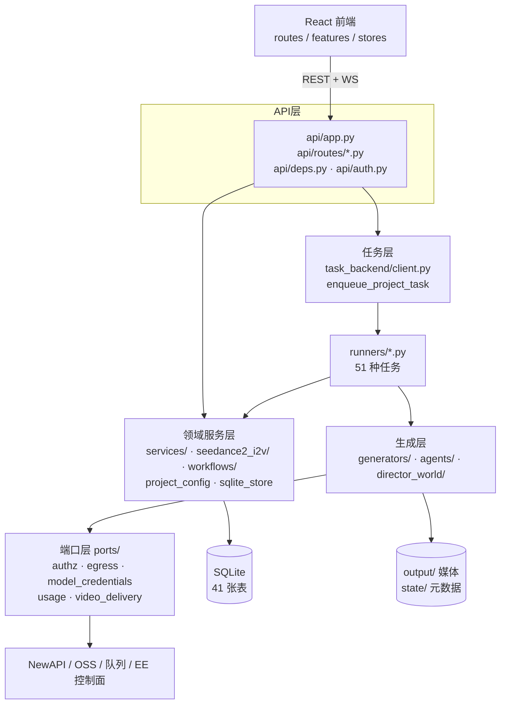
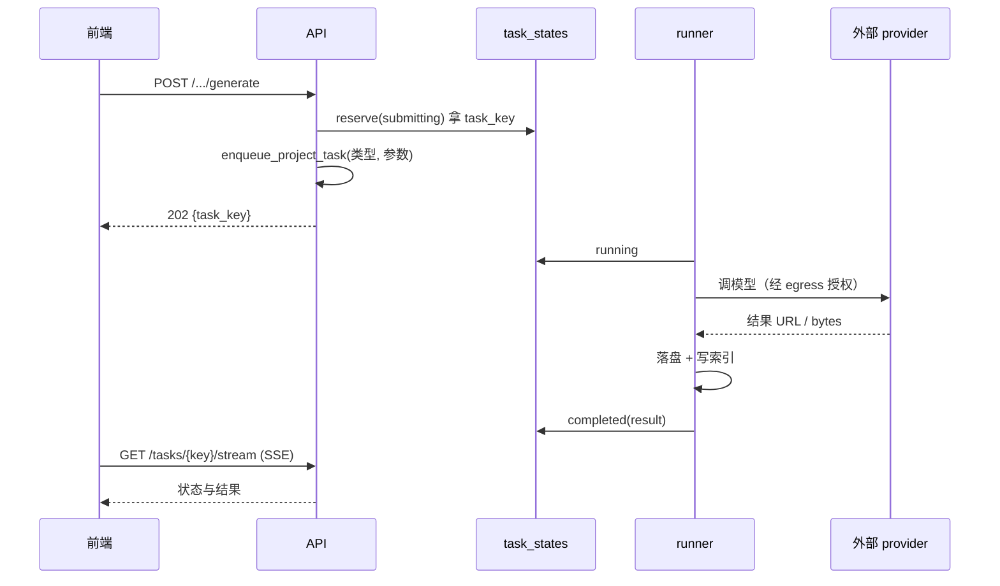

# 02 架构与分层

## 1. 运行时形态

CE 单机部署时一共五类进程，理解它们的边界是排障的前提：

| 进程 | 启动方式 | 职责 | 挂了会怎样 |
|---|---|---|---|
| **API** | `uvicorn novelvideo.api.wsgi:application` 或 `gunicorn -k api.gunicorn_worker.GracefulUvicornWorker` | REST + WebSocket + 静态媒体 + SSE | 前端全白；已投递任务仍在跑 |
| **任务执行** | CE 默认**同进程 inline**；多 worker 时 Celery | 跑 runner，产出文件、回写 `task_states` | 任务停在 `running`，需超时回收 |
| **前端** | `npm run dev` / Nginx 静态 | React SPA | 页面打不开，API 仍可用 |
| **NewAPI 网关** | 独立容器（`start-ce.sh` 拉起） | 统一模型入口，屏蔽上游差异 | 所有生成失败，报网关 5xx |
| **Agent 子进程** | API 按需 spawn | Codex / Claude / Hermes 执行对话与工具 | 仅影响对话，不影响已有产物 |

关键点：**API 不执行业务重活**。API 只做「参数校验 → 建任务 → 返回 task_key」，真正的生成在 runner 里。这让 API 可以短超时、可重启，也让任务能在 worker 里重试。

## 2. 分层



依赖方向是**单向**的，由三个 lint 脚本强制（[11 §2](11-脚本运维与备份.md)）：

- `lint_ce_imports.py`：CE 代码不得 import 控制面（EE）模块；
- `check_ce_port_closure.py`：所有跨版本能力必须经由已注册端口；
- `lint_ee_terms.py`：CE 源码/文案不得出现 EE 专有概念。

违反会在 CI 直接失败，不是风格建议。

## 3. 端口-适配器（移植点）

`ports/` 定义抽象，`ports/local/` 给 CE 实现，EE 在 `novelvideo.ports_bootstrap` 入口点里覆盖注册。`ports/registry.py` 里有 18 个 **EE 必需端口**，缺一个就在启动时报错：

| 端口 | 契约文件 | CE 实现 | 用途 |
|---|---|---|---|
| `auth` / `auth_session` | `ports/auth.py` | `FileAuthPort` / `LocalAuthSession` | 登录态 |
| `project_registry` / `project_access` | `ports/project.py` | `SQLiteProjectRegistry` / `AllowAllProjectAccess` | 项目注册与权限 |
| `audit_sink` | `ports/audit.py` | `NoOpAuditSink` | 审计事件 |
| `credit_quote` | `ports/credit_quote.py` | `LocalCreditQuote` | 生成前报价 |
| `usage_meter` / `provider_instrumentation` | `ports/usage.py` | `NoOpUsageMeter` / `NoOpProviderInstrumentation` | 计量 |
| `task_backend` / `cancellation_store` | `ports/tasks.py` | `InlineTaskBackend` / `InMemoryCancellationStore` | 任务投递与取消 |
| `task_envelope_consumer` | `task_backend/consumer.py` | 本地验签消费 | 任务信封 |
| `lifecycle` | `ports/lifecycle.py` | `NoOpLifecycle` | 启停钩子 |
| `product_surface_access` | `ports/product_surface_access.py` | `LocalProductSurfaceAccess` | 功能面可见性 |
| `model_credentials` | `ports/model_credentials.py` | `LocalModelCredentials` | 请求级模型凭据 |
| `authz` | `ports/authz.py` | `LocalAuthz` | 授权与准入 |
| `egress` / `egress_operations` | `ports/egress.py` / `egress_operations.py` | `LocalEgress` / `LocalEgressOperations` | 出网许可与幂等 |
| `video_result_delivery` | `ports/video_delivery.py` | CE 无归档投递 | 网关归档结果取回 |

两种运行模式的判定在 `shared/runtime_env.py`：设置 `ST_CONTROL_PLANE_DSN` 即认为走 EE 控制面，此时缺端口直接 `RuntimeError`，不降级。

## 4. 四条主要数据流

### 4.1 同步读（90% 的 GET）

`route → deps.get_project_context → sqlite_store → 组装响应 → make_static_url_for_context`

要点：**路径不入库**。数据库里只存 `name` / `id` / `anchor_id` 这类逻辑引用，真实文件路径由 `utils/path_resolver.py` 按项目目录规则算出来。所以移动项目目录不会让数据失效，但也意味着**不能手改文件名**。

### 4.2 异步任务（所有生成）



细节（配额、信封签名、幂等、取消）见 [05](05-任务系统.md)。

### 4.3 对话流（WebSocket）

`/api/v1/chat/ws` 是**双向**的：后端把 Agent 事件映射成 `chat` 事件推前端；前端把用户消息、工具结果、画布命令结果回传。三条后端（Claude SDK / Codex / Hermes）被 `chat/runtime_port.py` 抹平，见 [08](08-Agent与对话.md)。

### 4.4 画布（前端持有图，后端持有账本）

画布图结构在**前端内存**里，后端只负责：版本化存盘（`canvas_store.py`）、命令投递（`canvas_command_bridge.py`）、提交回主线（`slots.py`）。这是最容易误解的一处：**后端不解析画布的节点语义**，只按 schema 校验并落盘。

## 5. 目录即契约

```text
{DATA_ROOT}/
├── output/<user>/<project>/          对外产物（可被 /static 直出）
│   ├── characters/  scenes/  props/  资产参考图
│   ├── episodes/ep001/
│   │   ├── sketches/  renders/  videos/  audio/  grids/
│   │   └── final/                    成片、字幕
│   ├── freezone/                     画布：_uploads/ outputs/ canvases/ html/
│   └── director_worlds/<scene>/v1/   3GS 舞台（manifest/ply/glb/panorama）
├── state/<user>/<project>/           内部状态（不对外）
│   ├── data.db                       项目主库（30 张表）
│   ├── project_config.json           项目配置（风格/模型/旁白）
│   ├── cognee_system/                知识图谱（旧管线）
│   └── indexes/                      池索引 sidecar
├── state/<user>/_shared/             跨项目共享
│   ├── director_training.db          训练飞轮数据
│   └── verification.db               失败模式注册表
└── runtime/<user>/<project>/         临时（可删）
    ├── logs/  temp_sketch_panels/  staging/
```

三条硬规则：

1. **`output/` 可对外，`state/` 不可**。静态路由只挂 `output/`，且带项目级鉴权（`/static/projects/{project}/...`）。
2. **移动/删除整棵项目目录必须过 `security/project_storage.py`**。它校验路径归属，防止被篡改的 DB 记录导致误删别的项目。
3. **`runtime/` 可随时清空**，不含唯一数据；备份链路刻意跳过它（`backup/scope.py`）。

## 6. 五处反直觉设计

| 现象 | 真实原因 |
|---|---|
| `scenes.py` 里没有「场景图路径」字段 | 路径由 `compute_scene_master_path()` 算，DB 只存 scene 名 |
| 任务已经 `completed`，前端还显示「进行中」 | 前端按 SSE 事件更新，断线后需 `GET /tasks/{key}` 补一次快照 |
| 改 `.env` 不生效 | 多数配置在**进程启动时**读入；模型网关额外有 SQLite 覆盖层，见 [03 §3](03-配置与环境变量.md) |
| 同一张图在两个 beat 下都出现 | 图片池（pool）共享 cell，选中关系存在 `beats.selected_*`，不是复制文件 |
| 画布保存报 `CanvasRevisionConflict` | 乐观锁：`base_revision` 与磁盘不一致，需拉最新版本再合并 |

## 7. 想深入哪一层

| 关注点 | 去处 |
|---|---|
| 请求进来怎么鉴权、怎么解析项目 | [files/02-api层](files/02-api层.md)（`deps.py` / `auth.py` / `egress_binding.py`） |
| 任务怎么注册、怎么跑 | [05](05-任务系统.md) + [files/07](files/07-运行时与端口.md) |
| 生成器怎么调模型 | [07](07-生成流水线.md) + [files/04](files/04-agents与generators.md) |
| 画布怎么存 | [09](09-画布Freezone.md) + [files/06](files/06-freezone.md) |
| 前端怎么组织 | [10](10-前端应用.md) |
