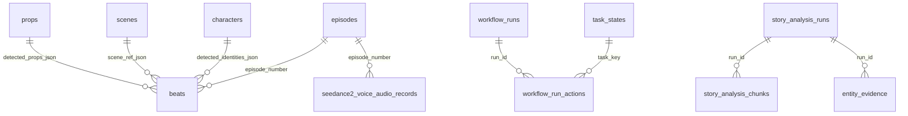

# 04 数据模型与 SQLite 表

## 1. 为什么是 SQLite，而不是一个 ORM 库

- **项目即目录**：一个项目的全部状态在 `state/<user>/<project>/data.db` 里，复制目录就能搬走项目（DB 是单文件，媒体在 `output/`）。
- **无迁移框架**：`sqlite_schema.py` 用「组件 + 版本」登记表（`novelvideo_schema_components`），每张表自己负责 `CREATE TABLE IF NOT EXISTS` 与幂等升级，跨进程用文件锁串行化。
- **并发模型**：WAL 模式 + `busy_timeout`，配置在 `sqlite_pragmas.py`。写少读多，任务写状态、前端读列表。

代价：**没有外键约束**，一致性靠代码保证；跨表查询要手写 SQL。改表结构时必须同时考虑「老库升级」和「新库初始化」两条路径。

## 2. 六个数据库文件

41 张表分散在 6 类文件里，搞错位置会查不到数据：

| 数据库 | 路径 | 表数 | 生命周期 |
|---|---|---:|---|
| 项目主库 | `state/<user>/<project>/data.db` | 26 | 随项目删除；单个项目最大 |
| 聊天库 | `state/<user>/<project>/chat.db`（home 作用域在 `_home/chat.db`，画布在 `_freezone/<id>/chat.db`） | 3 | 随会话清理 |
| 用户项目库 | `state/local/projects.db` | 2 | 全局，删项目后保留墓碑记录 |
| 运行时设置库 | `state/local/settings.db` | 1 | 全局，前端「模型网关」写入 |
| 用户共享库 | `state/<user>/_shared/director_training.db`、`verification.db` | 6 | 跨项目累积，备份需单独处理 |
| 其他单文件库 | `state/<user>/director_auto.db`、BrainClaw outcome 库、证据计数库 | 3 | 各模块自管 |

`novelvideo_schema_components`（schema 版本登记）在每个库中都存在，用于并发建表时的互斥与幂等，不计入业务表。

## 3. 项目主库：内容域（`sqlite_store.py`）

这是全系统最重要的 6 张表，`sqlite_store.py`（3,221 行）是唯一写入方。

| 表 | 主键 | 关键列 | 写入方 | 读方 | 注意 |
|---|---|---|---|---|---|
| `characters` | `name` | `aliases_json`、`is_main`、`identities_json`、`fish_voice_id` | 角色构建、手工增删 | 角色页、生成器、提示词 | `name` 同时是**目录名与 URL 段**，改名要走 `utils/identity_refs.py` 重映射 |
| `episodes` | `number` | `title`、`chapter_*`、`scene_menu_json`、`prop_menu_json`、`identity_*` | 分集规划 | 分集列表、身份规划 | 菜单是 JSON 快照，改了资产不会自动同步 |
| `beats` | `(episode_number, beat_number)` | `narration`、`visual_description`、`scene_ref_json`、`detected_*_json`、`selected_*` | 剧本生成、编辑、选图 | 工作台、视频生成 | **只有 20 列但承载全部 beat 状态**，新增字段要同步 `models.py` 的 `NovelVisualBeat` |
| `scenes` | `name` | `scene_type`、`base_scene_id`/`variant_id`、`environment_prompt` | 场景构建 | 场景工作台 | 派生场景（`base_of`）共用母场景资产 |
| `props` | `name` | `prop_type`、`visual_prompt`、`owner` | 道具菜单提升 | 道具工作台 | 与 PlayCanvas 3GS 道具通过 `sync_global_props` 同步 |
| `seedance2_voice_audio_records` | `(episode_number, beat_number, speaker)` | `audio_path`、`voice_sha256`、`text_sha256`、`status` | 对白音频任务 | 视频生成前校验 | 用**双哈希**判定缓存是否可用，改文本或换声音都会失效 |

## 4. 项目主库：生成记录与用量

| 表 | 主键 | 作用 | 清理 |
|---|---|---|---|
| `image_request_usage` | `request_id` | 每次图片请求一行，`status` 走 `accepted → completed/failed` | 保留（用于配额与审计） |
| `video_request_usage` | `request_id` | 视频请求，含 `duration_seconds`、`cost_estimate` | 保留 |
| `audio_request_usage` | `request_id` | 音频请求，含 `speaker`、`scope` | 保留 |
| `task_states` | `task_key` | 任务全生命周期快照（22 列） | `compute_expiry()` + `clear_project_completed_tasks` |
| `canvas_command_messages` | `bridge_key` | 画布命令 Inbox/Outbox | `expire_bridge_messages()` 按 `expires_at` |
| `workflow_runs` | `run_id` | 工作流运行账本 | `prune_workflow_runs()` |
| `workflow_run_actions` | `(run_id, node_id, action)` | 每个节点动作的状态与错误分类 | 随 run 清理 |
| `workflow_drafts` | `draft_id` | 工作流草稿（21 列，含编译产物） | `prune_expired_workflow_drafts()` |
| `freezone_agent_product_operations` | `operation_id` | Agent 生成的可计费产物身份 | 终态后保留作证据 |
| `freezone_recipe_model_prompts` | `(operation_id, model_call_id)` | Recipe 编译时的完整 prompt | 随 operation |
| `freezone_agent_generation_sessions` | `generation_session_id` | 一次画布生成会话的清单 | 会话结束保留 |

**用量表的设计意图**：先记 `accepted` 再更新终态。这样即使进程崩溃，也能知道「有一笔请求已发出但结果未知」，避免重复计费或漏账。视频表还有 `downloaded_at`，用于区分「已生成」与「已取回」。

## 5. 项目主库：结构化摄取与草图质量

| 表 | 主键 | 作用 |
|---|---|---|
| `story_analysis_runs` | `run_id` | 一次 `structured_v1` 抽取的元信息（源文本哈希、长度、状态） |
| `story_analysis_chunks` | `(run_id, chunk_id)` | 源文本切块，含 `source_start/end`、`attempts`、`result_json` |
| `story_analysis_item_cache` | `cache_key` | 单条抽取结果缓存（角色/场景/道具），跨 run 复用 |
| `story_analysis_artifacts` | `(run_id, artifact_type)` | 汇总产物（合并后角色表等） |
| `entity_evidence` | 无显式主键 | 实体 ←→ 原文片段的可追溯证据，用于反幻觉校验 |
| `convergence_rounds` | `id` | 每集每阶段的收敛轮次（残差数、修复数） |
| `sketch_failure_modes` | `code` | 项目级草图失败模式定义（阶段 1 遗留） |
| `sketch_failure_mode_hits` | `code` | 失败模式命中计数 |
| `novelvideo_schema_components` | `component` | schema 版本登记，防止并发建表 |

设计要点：抽取是**分块 + 缓存 + 证据**三件套。同一个 chunk 重跑不会重复调模型（缓存），每条结论都能回指原文（证据），失败可只重试单个 chunk（`attempts`）。

## 6. 聊天库（`chat/store.py`）

| 表 | 主键 | 说明 |
|---|---|---|
| `chat_messages` | `id` 自增 | `role` / `content` / `media_json` / `created_at`；首页与项目各自独立库 |
| `chat_settings` | `key` | 会话级 KV（当前 Agent 会话 id、选中的模型等） |
| `chat_ui_events` | `id` 自增 | 每轮的 UI 事件流（工具卡片、进度），按 `turn_id` 建索引 |

作用域决定文件位置：`home` → `_home/chat.db`；项目 → `<project>/chat.db`；画布 → `_freezone/<canvas_id>/chat.db`；技能工作室 → `_chat/surface/chat.db`。**删项目不会自动删 home 会话**。

## 7. 用户级与共享库

| 表 | 库 | 主键 | 作用 |
|---|---|---|---|
| `projects` | `projects.db` | `id` | 项目注册表：owner、三类目录、`status`、`purged_at` |
| `schema_migrations` | `projects.db` | `version` | 用户库迁移版本 |
| `runtime_settings` | `settings.db` | `key` | 网关模式、密文 key、媒体映射等（L2 配置层） |
| `director_auto_runs` | `director_auto.db` | `run_id` | 虾导自动模式的持久化运行态（基线任务、已处理任务） |
| `accepted_sketch_samples` | `director_training.db` | `sample_id` | 人工认可的草图样本，训练飞轮正样本 |
| `reject_buffer` | `director_training.db` | `reject_id` | 被拒样本与失败码 |
| `live_edit_traces` | `director_training.db` | `trace_id` | 37 列的完整调用链追踪（prompt/响应/门禁/覆盖） |
| `human_override_events` | `director_training.db` | `event_id` | 人工推翻门禁的记录 |
| `sketch_format_versions` | `director_training.db` | `version` | 草图格式版本与风格锁 |
| `sketch_failure_mode_defs` | `verification.db` | `code` | 全局失败模式定义（跨项目共享） |
| `evidence_counters` | 证据计数库 | `outcome` | 每个能力结果计数；`HALTING` 集合必须恒为 0 |
| `outcomes` | BrainClaw 运营库 | `identity` | 待上报的回执队列（`attempts`、`next_attempt`） |

`live_edit_traces` 的 37 列不是冗余：它是「同一 beat 多次尝试」的完整证据链，训练飞轮与回归分析都读它。大字段（prompt、模型响应）**不存 DB**，存 `verification/artifact_store.py` 的内容寻址文件，DB 只存哈希与路径。

## 8. 表间关系（核心链路）

注意这些线**没有外键**：`beats.scene_ref_json` 里存的是场景名，场景被删后 beat 仍指向旧名，读取时靠 `resolve_scene_record_name()` 兜底。

## 9. 改表的正确姿势

1. 新表 → 在所属模块里写 `CREATE TABLE IF NOT EXISTS`，并在 `sqlite_schema.py` 里 `mark_schema_component(component, version)` 递增版本。
2. 加列 → 先 `PRAGMA table_info` 判断存在性，再 `ALTER TABLE ADD COLUMN`（SQLite 不支持 `IF NOT EXISTS` 加列）。
3. 改列类型/删列 → SQLite 需重建表：建新表 → 复制 → 改名。必须放在事务里，且先备份（[11 §3](11-脚本运维与备份.md)）。
4. 改完同步三处：`models.py` 数据类、`api/schemas.py` 响应模型、本篇表格。

## 10. 五个容易踩的坑

| 坑 | 现象 | 处理 |
|---|---|---|
| 直接 `sqlite3 data.db` 改数据 | 服务端缓存与索引 sidecar 不一致 | 停服务再改，或改完调 `rebuild_pool_index` |
| 项目目录整体拷贝后 ID 冲突 | `projects.db` 里 `id` 重复 | 走 `projects` 表重新注册，别只拷目录 |
| 删除 `-wal` 文件 | 最近事务丢失 | 只通过 `VACUUM INTO` 做快照（`backup/db_daily.py`） |
| 在 `data.db` 里存路径 | 换机器/改目录后全失效 | 只存 name/id，路径用 `path_resolver` 计算 |
| 共享库随项目清理 | 训练样本与失败模式被误删 | `backup/scope.py` 已排除 `_shared`，清理脚本也要排除 |
