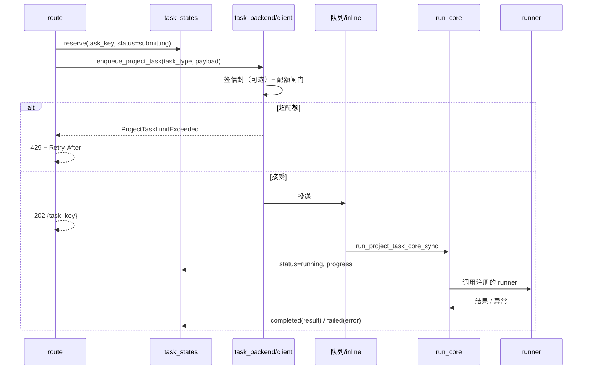

# 05 任务系统

所有耗时操作都是任务：上传解析、分集、剧本、资产图、草图、渲染、视频、音频、合成、画布生成、3GS 构建。理解这一层等于理解系统的心跳。

## 1. 一次任务的完整路径



任务键（`task_key`）不是随机串：它由 `task_identity.py` 按「作用域 + 任务类型 + 目标」生成哈希（`task_state_key` / `project_task_state_key`）。**同一目标重复提交会命中同一个键**，这是幂等的基础，也意味着「重跑」必须显式换 scope（例如带 attempt 后缀）。

## 2. 51 种任务类型 → runner

全部注册在 `task_backend/runners/`（17 个模块）里，`runners/__init__.py` 导入即注册。按业务域分组：

### 2.1 摄取、构建与规划（10）

| 任务类型 | runner | 模块 | 触发端点 |
|---|---|---|---|
| `ingest_fast` | `run_ingest_fast` | `ingest.py` | `POST /projects/{p}/ingest/start` |
| `build_characters` | `run_build_characters` | `graph_build.py` | `POST /projects/{p}/characters/build` |
| `build_scenes` | `run_build_scenes` | `graph_build.py` | `POST /projects/{p}/scenes/build` |
| `build_props` | `run_build_props` | `graph_build.py` | `POST /projects/{p}/props/build` |
| `build_episodes` | `run_build_episodes` | `graph_build.py` | `POST /projects/{p}/episodes/plan` |
| `identity_planner` | `run_identity_planner` | `identity.py` | `POST .../identities/plan` |
| `episode_scene_planner` | `run_episode_asset_planner` | `episode_assets.py` | `POST .../scenes/plan` |
| `episode_prop_planner` | `run_episode_asset_planner` | `episode_assets.py` | `POST .../props/plan` |
| `sketch_edit_execute` | `run_sketch_edit_execute` | `sketch_edit_execute.py` | 验证 API |
| `skill_import`（内部） | `run_skill_import` | `skill_import.py` | `POST .../freezone/skill-imports` |

### 2.2 剧本与提示词（2）

| 任务类型 | runner | 说明 |
|---|---|---|
| `script_writer` | `run_script_writer` | 逐行剧本 → beats（`literal_script_writing`） |
| `beat_video_prompt` | `run_beat_video_prompt` | 单 beat 视频提示词 |

### 2.3 资产图（4）

| 任务类型 | runner | 产出 |
|---|---|---|
| `character_portrait` | `run_character_image` | 角色肖像 |
| `identity_image` | `run_character_image` | 身份图/服装图（同一 runner，`mode` 区分） |
| `prop_reference_asset` | `run_prop_reference_asset` | 道具三视图 |
| `scene_reference_asset` | `run_scene_reference_asset` | 场景母版/反打参考图 |

### 2.4 草图与渲染（5）

| 任务类型 | runner | 说明 |
|---|---|---|
| `sketch_generation` | `run_sketch_generation` | 分镜草图（3×3 / 5×5 网格切分） |
| `sketch_grid_generation` | `run_sketch_generation` | 整集网格 |
| `director_control_to_sketch` | `run_sketch_generation` | 3GS 控制帧转草图 |
| `grid_regenerate` | `run_grid_regenerate` | 整网格重生成 |
| `sketch_regen` / `selected_regen` | `run_sketch_regen` / `run_selected_regen` | 单格/多格重生成 |

### 2.5 视频与合成（4）

| 任务类型 | runner | 说明 |
|---|---|---|
| `single_video` | `run_single_video` | 单 beat 视频 |
| `compose_episode` | `run_compose_episode` | 整集合成（FFmpeg） |
| `global_optimize_video` | `run_global_optimize_video` | 整集提示词优化（一次性） |
| `freezone_video_gen` | `run_freezone_video_gen` | 画布视频节点 |

### 2.6 音频（2）

| 任务类型 | runner | 说明 |
|---|---|---|
| `system_voice_setup` | `run_system_voice_setup` | 预生成系统音色 |
| `indextts2_audio`（内部） | `run_indextts2_audio` | IndexTTS2 对白/旁白 |

### 2.7 舞台与 3GS（3）

| 任务类型 | runner | 说明 |
|---|---|---|
| `stage_asset` | `run_stage_asset` | 3GS 构建（子进程：SHARP/DA2） |
| `scene_pano_generation` | `run_scene_pano_generation` | 360 全景 |
| `freezone_image_to_3gs` | `run_freezone_image_to_3gs` | 画布图转 3GS |

### 2.8 画布 Freezone（23）

`runners/freezone.py` 一个文件注册了 **23** 个类型，是任务数最多的地方。另有 2 个画布相关类型注册在别处：`freezone_video_gen`（`video.py`）、`freezone_image_to_3gs`（`stage_asset.py`）。

| 类别 | 任务类型 |
|---|---|
| 图 | `freezone_gen`、`freezone_edit`、`freezone_mask_edit`、`freezone_image_vectorize`、`freezone_image_animate_gif`、`freezone_image_reverse_prompt` |
| 视频 | `freezone_video_gen`（在 `video.py`）、`freezone_video_erase`、`freezone_video_upscale`、`freezone_video_compose`、`freezone_video_breakdown`、`freezone_video_story` |
| 音频 | `freezone_audio_separate`、`freezone_audio_speech`、`freezone_audio_eleven_music` |
| 文本 | `freezone_text_translate`、`freezone_text_generate`、`freezone_story_script` |
| 分析 | `freezone_extract`、`freezone_analyze` |
| 主线协同 | `mainline_sketch_from_context`、`mainline_frame_from_context`、`mainline_director_control_sketch` |
| 工作流 | `freezone_workflow_confirm` |

> 数字说明：全仓 `register_project_task_runner` 共 **51** 条注册，51 个唯一类型，无重复注册。第一版文档写的「28 种」是 grep 转义导致的漏计，本版已用 AST/正则双重核对。

## 3. 四条泳道与五道闸门

任务按资源类型分泳道（`queues.py`，只允许 `default` / `video` / `world` / `ffmpeg`，拼错直接报错，不再静默落到 default）：

| 泳道 | 项目并发上限 | 单用户项目内上限 | 全局执行槽 | 全局排队上限 |
|---|---:|---:|---:|---:|
| `default` | 12 | 3 | 8 | 512 |
| `video` | 4 | 1 | 2 | 128 |
| `world` | 2 | 1 | 1 | 64 |
| `ffmpeg` | 2 | 1 | 1 | 64 |

默认值在 `limits.py`，可被环境变量覆盖：`ST_PROJECT_MAX_ACTIVE_{LANE}`、`ST_PROJECT_MIN_ACTIVE_{LANE}`、`ST_PROJECT_USER_MAX_ACTIVE_{LANE}`、`ST_CE_GLOBAL_MAX_ACTIVE_{LANE}`、`ST_CE_GLOBAL_MAX_QUEUED_{LANE}`。

五道闸门依次拦截：

1. **全局排队**（`GlobalLaneQueueLimitExceeded`）——总待处理量，防止内存排队打爆。
2. **全局执行**（`ST_CE_GLOBAL_MAX_ACTIVE_*`）——真正同时在跑的槽位。
3. **项目总量**（`ProjectTaskLimitExceeded`）——单项目占满整个部署。
4. **项目内单用户**（`ProjectUserTaskLimitExceeded`）——一个人刷满团队额度。
5. **渠道/用户级**（`ChannelTaskLimitExceeded` / `UserTaskLimitExceeded`）——队列后端特有（EE 多租户）。

`project_lane_effective_active_limit()` 还会按「有资格的用户数」动态下调：用户少时不会让一个人独占 12 个槽，避免单点把项目堵死。

## 4. 状态机

`task_state.py` 定义的状态集合：

```text
submitting ──► queued ──► running ──► completed
     │            │           ├──────► failed
     └────────────┴───────────┴──────► cancelled
```

| 分组 | 值 | 含义 |
|---|---|---|
| `ACTIVE_PROJECT_TASK_STATUSES` | `submitting`、`queued`、`running` | 占配额 |
| `TERMINAL_TASK_STATUSES` | `completed`、`failed`、`cancelled` | 释放配额 |

`task_states` 表 22 列，关键字段：

| 字段 | 用途 |
|---|---|
| `task_key` | 主键，幂等标识 |
| `task_id` | 后端任务 id（Celery task id / job id） |
| `task_type` / `queue_kind` | 决定 runner 与泳道 |
| `project_id` / `requester_user_id` | 配额与归属 |
| `status` / `progress` / `current_task` | 前端进度条数据源 |
| `result_json` / `error` / `logs_json` | 终态产物与失败原因 |
| `expires_at` | 过期回收时间（`compute_expiry`） |

**为什么状态要落库而不是放内存**：worker 可能被 kill、可能换进程、用户可能刷新页面。落库后，`GET /tasks/{key}` 能在任何时刻重建视图；SSE 只是加速通道，不是唯一来源。

## 5. 任务信封（签名）

多 worker / 多机时，任务参数在传输中可能被篡改或伪造。`task_backend/envelope.py` 定义了 `SignedTaskEnvelope`：

- 载荷含 `project_id`、`home_node_id`、`task_type`、`payload`、`issued_at`、`expires_at`、`nonce`；
- 用 HMAC 签名，密钥来自 `ST_TASK_ENVELOPE_KEYRING_B64_JSON`，`ACTIVE_KEY_ID` 指定当前签名键；
- keyring 可同时保留退役键，支持轮换窗口内验签；
- 校验失败抛 `InvalidTaskEnvelope` / `StaleTaskEnvelope`，**不降级执行**。

单机部署可全部留空：`signing.load_or_create_local_signing_config()` 会自动生成本地密钥并持久化。

## 6. 幂等、重试与错误分类

| 机制 | 位置 | 行为 |
|---|---|---|
| 幂等键 | `task_state_key` / `canvas_command_idempotency_key` | 同键重复投递返回既有任务，不重复扣费 |
| 重试计数 | `workflow_run_actions.retry_count` | 只对 `retryable=true` 的错误重试 |
| 错误分类 | `workflow_runs.classify_workflow_error` | 归为 provider / timeout / cancelled / validation / internal |
| 失败指纹 | `error_fingerprint` | 同类失败聚合，避免刷屏 |
| 终态回收 | `terminalize_undelivered_agent_product_task` | 已扣费但未交付的任务回滚 |

**重要**：生成类任务默认**不自动重试**。图片/视频调用可能已计费，自动重试等于重复扣钱。重试由用户或上层工作流显式触发。

## 7. 取消与超时

- API：`POST /projects/{p}/tasks/{task_key}/cancel` → `request_cancel()` 写取消标记；
- runner 侧：`await_with_cancel_watch()` 在等待外部调用时轮询标记，抛出 `TaskCancelled`；
- 子进程：`task_backend/subprocesses.py` 记录每个任务派生的 PID，`kill_task_processes()` 整组清理（FFmpeg、3GS 构建必须杀干净，否则文件被占用）；
- 超时：`TaskTimedOut` 由 `remaining_timeout_seconds()` 计算，与 `expires_at` 对齐。

取消是**协作式**的：已经在 provider 侧排队的外部任务无法撤回，只能丢弃结果。这类情况会在 `result_json` 里留 `discarded` 标记。

## 8. 迟到订阅与断线恢复

前端订阅 `GET /projects/{p}/tasks/{key}/stream`（SSE）或 `WS /chat/ws`。三个要点：

1. **订阅前先取快照**：`GET /tasks/{key}` 拿当前状态，再订阅；否则可能错过「订阅建立前已完成」的任务。
2. **SSE 有终止事件**：`api/sse_shutdown.py` 在进程关闭时发终止事件，避免前端无限重连。
3. **进程重启后任务可能失联**：`status=running` 但 worker 已死的任务，需要 `interrupt_stale_workflow_runs()` / 超时回收，见 [14 §5](14-常见问题.md)。

## 9. 排障判定顺序

遇到「任务不动了」，按这个顺序判断，别一上来就翻日志：

| 现象 | 先查 | 判定 |
|---|---|---|
| 一直 `submitting` | `task_states.status` 是否被后续请求覆盖 | 投递失败但状态已预留 → 补一次 enqueue |
| `queued` 很久 | 泳道配额与全局槽 | 超配额 → 429 应在投递时就返回；若无 429，是队列后端没消费 |
| `running` 无进度 | `logs_json` 最后一条 + 子进程是否存活 | 卡在外部 API → 看 provider 超时；子进程死了 → 超时回收 |
| `failed` 但无 `error` | `result_json` | runner 抛了非标准异常，被兜底吞掉 |
| 前端看不到结果 | `GET /tasks/{key}` 直连 | SSE 断线 → 前端需补快照 |

## 10. 新增一种任务

五步，缺一不可：

1. `runners/<域>.py` 写 `run_xxx(ctx, payload)`，签名与既有 runner 一致；
2. 同文件调用 `register_project_task_runner("xxx", run_xxx, queue_kind="video")`；
3. `api/routes/*.py` 加端点：校验参数 → `reserve` → `enqueue_project_task`；
4. `api/schemas.py` 加请求/响应模型；
5. `tests/contract/` 加契约测试（参考 `test_m*_route_contracts.py`）。

第 2 步的 `queue_kind` 决定配额，选错会让视频任务挤占 `default` 泳道，整站变慢。
