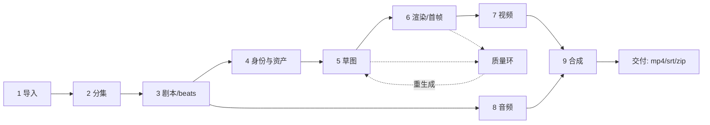

# 07 生成流水线

从一本小说到一集成片，共九段。每段都有明确的输入、输出、落库位置与失败模式。理解「产物在哪、下一段从哪读」比记住调用链更重要。



## 1. 导入

| 项 | 内容 |
|---|---|
| 入口 | `POST /projects/{p}/ingest/upload` → `POST /projects/{p}/ingest/start` |
| 任务 | `ingest_fast`（`runners/ingest.py`） |
| 关键文件 | `api/routes/ingest.py`、`structured_ingest.py`、`story_analysis.py`、`cognee/pipeline.py`、`cognee/store.py` |
| 输入 | `.txt` / `.docx` / 剧本格式文本 |
| 输出 | `state/.../data.db` 的 `story_analysis_runs/chunks/item_cache/artifacts`；旧管线写 `cognee_system/` 图谱 |
| 下一段读 | 分集规划读 `episodes` 表与源文本 |

两条管线（`knowledge_pipeline.py`）**长期并存**，由项目创建时决定，不可中途切换：

| 管线 | 适用 | 代价 |
|---|---|---|
| `structured_v1`（默认） | 新项目 | 分块抽取，无图谱；证据存 `entity_evidence` |
| `cognee_legacy` | 老项目 | 需嵌入模型与向量库，慢但关系更丰富 |

失败模式：文本编码识别错（`document_parsers.decode_novel_bytes`）、docx 结构异常、章节检测不到（`chapter_detector` 返回空）、付费字数统计与预期不符（`count_billable_novel_chars`）。

## 2. 分集

| 项 | 内容 |
|---|---|
| 入口 | `POST /projects/{p}/episodes/plan` |
| 任务 | `build_episodes` |
| 关键文件 | `agents/episode_planner.py`、`agents/episode_reviewer.py`、`agents/episode_fixer.py`、`cognee/event_extractor.py` |
| 输入 | 源文本 + 章节结构 + 目标集数 |
| 输出 | `episodes` 表（`title`、`chapter_*`、`content_summary`、`main_conflict`、`cliffhanger`、`key_events`） |
| 质量环 | planner → reviewer（打分/列问题）→ fixer（补丁修复），最多 N 轮 |

三个 Agent 的分工是**生成-审核-修复**，不是三次重试。`episode_fixer` 产出的是结构化 patch（`EpisodePatch`），可只改有问题的字段。

注意：这是**全量重规划**。已有 beats 会被覆盖，接口没有「增量插入一集」的语义。

## 3. 剧本与 beats

| 项 | 内容 |
|---|---|
| 入口 | `POST /projects/{p}/episodes/{n}/script/generate`（按集） |
| 任务 | `script_writer` |
| 关键文件 | `workflows/literal_script_writing.py`（1,520 行）、`workflows/script_writing.py`（薄封装）、`models.py` |
| 输入 | 原文 + 分集元数据 + 风格/语种 |
| 输出 | `beats` 表：一行一个 beat，`narration`、`visual_description`、`scene_ref_json`、`detected_*_json` |

2.0 的主线是**逐行模式**：原文一行 → 一个 beat，文本保留，LLM 只补元数据（镜头类型、景别、时间、角色标记）。旧的「先出完整剧本再解析」链路仍在（`cognee/script_parser.py`），但不是默认路径。

为什么改成逐行：剧本-first 的解析器对格式极敏感，作者一改标点就错位；逐行模式把「结构」和「文本」解耦，错也只错一个 beat。

## 4. 身份与资产

这一段最容易混，四个概念要分清：

| 概念 | 表 | 含义 | 生成物 |
|---|---|---|---|
| 角色 character | `characters` | 一个人物 | 无（只是条目） |
| 身份 identity | `characters.identities_json` | 同一人物在不同时期/装扮 | 身份图、服装图、肖像 |
| 场景 scene | `scenes` | 一个地点（可分派生场景） | 母版图、反打图、全景、3GS |
| 道具 prop | `props` | 一件关键物件 | 三视图参考图 |

流程：

1. `identity_planner`（`agents/identity_planner.py`）按集分析出场角色，产出「默认身份 + 本集身份需求」，三段可分别配模型（选角/分析/外貌）；
2. `asset_compiler`（`agents/asset_compiler.py`，1,806 行）以 SceneBlock 为单位编译本集需要的场景与道具，产出 `scene_menu_json` / `prop_menu_json`；
3. 资产图任务：`character_portrait`、`identity_image`、`scene_reference_asset`、`prop_reference_asset`；
4. 文件落 `output/<user>/<project>/{characters,scenes,props}/`，路径由 `utils/path_resolver.py` 计算。

关键约束：**identity_id 的格式是 `<角色名>_<身份名>`**。角色改名必须走 `utils/identity_refs.remap_identity_id()` 全量重映射，否则历史 beat 里的标记全部悬空。

## 5. 草图

| 项 | 内容 |
|---|---|
| 入口 | `POST /projects/{p}/episodes/{n}/sketches/generate` |
| 任务 | `sketch_generation` / `sketch_grid_generation` |
| 关键文件 | `generators/nanobanana_grid.py`（7,996 行）、`generators/prompt_builder.py`（3,945 行）、`generators/grid_splitter.py`、`generators/pool_indexer.py`、`generators/sketch_color_detector.py` |
| 输入 | beats + 角色颜色映射 + 场景参考 + 风格 |
| 输出 | 网格图（3×3 / 5×5）→ 切分为 cell → 图片池索引 → 选中写入 `beats.selected_sketch_*` |

三件事同时发生在这一层：

1. **构图**：草图只表达「谁在哪做什么」，不追求画面质量，方便低成本试错；
2. **身份标注**：每个角色分配一个颜色，草图上用色块区分，后续 `sketch_color_detector` 反查；
3. **池化**：同一 beat 的多张候选进池（`pool_indexer`），选中的才成为「当前草图」，其余保留可切换。

失败模式：网格切分错位（`perfect_grid_split` 对不齐）、角色颜色被模型改色、cell 缺失（模型少画一格）、身份检测不到。质量环见 §10。

## 6. 渲染与首帧

| 项 | 内容 |
|---|---|
| 入口 | `POST /projects/{p}/episodes/{n}/render` |
| 任务 | `grid_regenerate` / `selected_regen` / `sketch_regen` |
| 关键文件 | `generators/nanobanana_grid.py`（render 模式）、`generators/prompt_builder.py`、`services/background_anchor_service.py`、`api/viewer_manifests.py` |
| 输入 | 选中草图 + 角色参考 + 场景母版 + 风格 |
| 输出 | 高清渲染图（首帧），落 `renders/`，可指定背景锚点（`background_anchor`） |

渲染与草图的差异在 prompt 策略：草图用 `SketchModeStrategy`（线稿、简脸），渲染用 `RenderModeStrategy`（材质、光影、色彩），两者共享 `PromptContext`。

「背景锚点」是一个实用设计：同一场景多个 beat，可以让所有首帧的地平线/门窗位置对齐，避免剪辑时跳。锚点只存 id，路径实时计算。

## 7. 视频

| 项 | 内容 |
|---|---|
| 入口 | `POST .../beats/{n}/video` 或 `POST .../videos/compose` |
| 任务 | `single_video`、`freezone_video_gen` |
| 关键文件 | `generators/video_generator.py`（4,825 行，含 8 个后端类）、`seedance2_i2v/*`、`generators/video_pool_indexer.py`、`agents/video_prompt_builder.py`、`agents/keyframe_prompt_builder.py`、`agents/global_video_optimizer.py` |
| 输入 | 首帧图 + 运动提示词（+ 可选尾帧/参考音） |
| 输出 | mp4 落 `videos/`，进视频池；选中关系写 `beats.selected_video_*` |

后端在 `VideoBackend` 枚举里，CE 实际走 NewAPI：`seedance`、`seedance2`、`grok`、`huimeng`、`comfyui`、`mock`。`create_video_generator()` 按配置与可用性选择，首次调用会探测后端能力（`get_video_backend_options`）。

Seedance 2.0 是当前主推：支持多参考图 + 对白音频 + 时长约束，前置校验在 `seedance2_i2v/pipeline.py`，任何一项不满足都**在提交前**报错，避免白扣费。

## 8. 音频

| 项 | 内容 |
|---|---|
| 入口 | `POST .../beats/{n}/audio`、`POST .../audio/generate` |
| 任务 | `system_voice_setup`、`indextts2_audio` |
| 关键文件 | `generators/tts_generator.py`、`generators/indextts2_fal.py`、`seedance2_i2v/voice_clone.py`、`audio/indextts2_beat_audio_task.py`、`seedance2_i2v/character_voice_storage.py` |
| 输入 | 文本（旁白/对白）+ 音色（系统音色或角色参考音） |
| 输出 | wav/mp3 落 `audio/`；对白音频额外写 `seedance2_voice_audio_records` |

两套语音：

- **旁白**：项目级旁白音色（`narrator_voice`），一集一条连续narration；
- **对白**：按 `speaker` 分轨，每个 identity 一个音色，供视频模型做口型/参考音。

缓存的判定是**双哈希**：`text_sha256` + `voice_sha256`。改一个字或换一个音色都会重新生成，但只改标点通常命中缓存。

## 9. 合成与交付

| 项 | 内容 |
|---|---|
| 入口 | `POST .../compose`、`GET .../export/srt`、`GET .../export/zip` |
| 任务 | `compose_episode` |
| 关键文件 | `generators/video_composer.py`、`export/episode_export.py`、`manual_shots.py` |
| 输入 | 选中视频片段 + 音频 + 字幕时间轴 + 转场设置 |
| 输出 | `final/*.mp4`、`.srt`、打包 zip |

合成用 FFmpeg（`MoviePyComposer` 是备选）。字幕时间由 `build_subtitle_timing_entries()` 依据每个 beat 的实际音频时长推算，**不是按固定字数**，所以换音色/改语速后字幕会跟着变。

手工插入的 beat（`is_manual_shot`）在这一层特殊处理：无音频、固定时长，`manual_shots.py` 负责排序与补齐。

## 10. 质量环（贯穿 5–7）

不是一条独立流水线，而是围绕草图的闭环：

```text
生成候选 → T1 颜色预筛 → T2 事实核查 → T3 评分 → T4 对比 → 选优/重生成
                                    ↓
                          失败模式登记 → 负向提示词
```

| 环节 | 文件 | 作用 |
|---|---|---|
| T1 颜色预筛 | `generators/sketch_color_detector.py` | 草图上没有该角色的颜色 → 直接判失败 |
| T2 事实核查 | `verification/image_verifier.py`、`frame_verifier.py` | 画面元素与 `visual_description` 是否一致 |
| T3 评分 | `verification/sketch_scorer.py` | 内容匹配度打分 |
| T4 对比 | `verification/sketch_comparer.py` | 多候选择优 |
| 视觉门禁 | `verification/sketch_visual_gate.py` | VLM 逐格判定，产出 `CellVerdict` |
| 失败模式库 | `verification/failure_registry.py`、`global_registry_db.py` | `code → 负向提示词片段`，命中后自动加入 prompt |
| 追踪 | `verification/replay_capture.py`、`training_db.py` | 每次尝试的 prompt/响应/判定全量留痕 |

失败模式库是**跨项目共享**的（`state/<user>/_shared/verification.db`）：一个项目发现的「六指」问题，会在所有项目里变成负向提示词。这是这个系统里少见的有状态学习机制。

## 11. 一条链路的真实耗时分布

按典型 60 集项目估算（仅用于判断瓶颈，非承诺）：

| 阶段 | 相对耗时 | 可并行度 |
|---|---|---|
| 导入 + 分集 | 低 | 低（一次性） |
| 剧本 | 中 | 按集并行 |
| 资产图 | 中 | 高（角色/场景/道具互相独立） |
| 草图 | 高 | 按集并行，集内按网格 |
| 渲染 | 高 | 按 beat |
| 视频 | **最高** | 按 beat，受 `video` 泳道限制（全局 2 槽） |
| 音频 | 低 | 按 beat |
| 合成 | 中 | 按集 |

瓶颈几乎总在视频：`video` 泳道全局并发默认 2。想提速先调 `ST_CE_GLOBAL_MAX_ACTIVE_VIDEO`，但要确认上游配额扛得住。

## 12. 相关文档

| 想知道 | 去哪 |
|---|---|
| 每个生成器文件的细节 | [files/04-agents与generators](files/04-agents与generators.md) |
| 任务怎么排队、怎么取消 | [05](05-任务系统.md) |
| 产物路径规则 | [02 §5](02-架构与分层.md) |
| 画布里做同样的事 | [09](09-画布Freezone.md) |
| 验证系统全部文件 | [files/09-utils与verification](files/09-utils与verification.md) |
