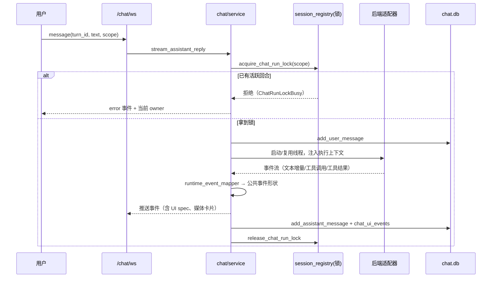

# 08 Agent 与对话

对话不是「把消息发给模型」，而是一个受锁保护、有作用域、能落库回放的回合系统。这一层代码量排在第二位（`chat/` 32 文件、21,963 行），仅次于路由层。

## 1. 三个后端

| 后端 | 适配文件 | 通信方式 | 能力差异 |
|---|---|---|---|
| **codex**（默认） | `chat/backend_sdk.py`（`CodexClient`）、`chat/codex_app_server.py` | Codex App Server（stdio/私有套接字） | 工具直连、支持 Responses Tool Search |
| **claude** | `chat/backend_sdk.py`（`ClaudeSdkClient` / `ClaudeCliClient`） | Claude Agent SDK 或 CLI | 需要 MCP 桥接工具 |
| **hermes** | `chat/hermes_sdk.py` | ACP（Agent Client Protocol）over stdio | 能力最全，需装 Hermes fork |

选择规则（`service._chat_backend()`）：

1. 读 `DRAMACLAW_CHAT_BACKEND`，其次 `SUPERTALE_CHAT_BACKEND`，默认 `codex`；
2. 指定了但不可用 → **直接抛错，不静默回退**。这是有意设计：静默回退会让「为什么模型行为变了」无从追查。

三条各自的硬前置：

- codex：`CODEX_BIN` 必须指向**打过补丁**的运行时。SDK 自带的 0.147 会明文记录每轮网关凭据，`deploy/codex/*.patch` 与 `deploy/codex/verify_runtime.py` 负责校验。
- claude：`_claude_cli_path()` 存在且 SDK 可导入。
- hermes：`hermes-agent[acp]` 已安装，且 fork 已装（`hermes_fork_requirement.require_hermes_fork()`）。

## 2. 一次回合的生命周期

关键点：

- **锁是文件锁 + 心跳**（`session_registry.py`），不是内存锁。这样多 worker / 进程重启后仍能判断「上一回合是否还活着」。
- 锁的 owner 信息（pid、主机、开始时间）会写进 lock 文件；心跳超时视为陈旧，可被 `force_release_chat_run_lock` 清理。
- 回合结束**无论成败**都要释放锁；异常路径由 `finally` 覆盖。

## 3. 作用域（scope）

同一个「对话」在不同入口是不同库、不同上下文：

| 作用域 | 库位置 | 上下文注入 |
|---|---|---|
| `home` | `state/<user>/_home/chat.db` | 项目列表、全局操作 |
| `project` | `state/<user>/<project>/chat.db` | 当前项目、当前集 |
| `freezone canvas` | `state/<user>/_freezone/<canvas_id>/chat.db` | 画布快照、选中节点 |
| `surface`（技能工作室） | `<project>/_chat/<surface>/chat.db` | 特定工具面 |

`execution_context.AgentExecutionContext` 是**服务端权威**的身份与策略载体：用户、项目、可见工具、计费主体都在这里确定，前端传的 scope 只用于定位，不作为授权依据。

## 4. 工具面与策略

`chat/tool_policy.py` 决定「这一轮给模型看哪些工具」：

| 函数 | 决策 |
|---|---|
| `tool_mode_for_surface()` | 主线 / 画布 / 技能工作室 三种工具集 |
| `surface_context_has_freezone_canvas()` | 是否启用画布命令类工具 |
| `freezone_canvas_execution_mode_from_context()` | 只读 / 可写 |
| `allows_mainline_media_ui_specs()` | 是否允许返回媒体预览卡片 |
| `is_hidden_chat_tool_event()` | 哪些工具事件不展示给用户（内部探测类） |

工具不是「全给模型自己挑」：范围先由服务端裁剪，模型只在裁剪后的集合里选。这是防止越权的主要手段。

## 5. MCP 桥

| 桥 | 文件 | 面向 | 读写 |
|---|---|---|---|
| DramaClaw 工具桥 | `chat/dramaclaw_mcp.py` | Claude / Codex 等通用 MCP 客户端 | 读写（受 scope 限制） |
| 工作流桥 | `chat/workflow_mcp.py` | 共享 Workflow Skill / Recipe | **只读 + 编译**，不执行 |

Hermes 不用 MCP 桥：它直接读 `.hermes/plugins/dramaclaw` 插件目录（`hermes_workspace.py` 幂等生成）。这解释了为什么 Hermes 的工具行为与另外两个后端略有差异。

`workflow_mcp` 刻意不给执行权：编译工作流 → 返回命令 → 前端画布执行。执行权始终在画布侧，避免 Agent 直接改用户画布。

## 6. 事件映射与呈现

后端事件形状各不相同，统一在四层里抹平：

| 层 | 文件 | 职责 |
|---|---|---|
| 事件映射 | `runtime_event_mapper.py` | 生命周期/进度/工具事件 → 公共 payload |
| 呈现映射 | `presentation_mapping.py`、`presentation.py` | 工具结果 → UI spec（卡片、表格、媒体） |
| 文本处理 | `presentation_text.py` | 增量拼接、去重、截断 |
| 兜底 | `display_fallback.py` | 模型没给结构化结果时，从权威数据重建展示 |

`canvas_outcome.py` 是画布操作的**回执契约**：Agent 说「我画好了」不算数，必须带 receipt（操作 id），服务端据此校验产物确实存在。

## 7. Hermes 池与工作区

Hermes 是重进程（每个会话一个 ACP 子进程），所以有两层复用：

- **工作区**（`hermes_workspace.py`）：`state/<user>/.hermes/` 幂等物化，包含插件、技能、Python hook 目录；
- **连接池**（`hermes_pool.py`）：每用户每 agent profile 最多一个 `HermesSdkClient`，会话在其上多路复用。

三个约束：

1. **网关指纹**：`gateway_origin_fingerprint()` 变了（换网关地址/凭据），旧连接判定不可复用，需重建。这就是「改了网关设置后对话要重开」的原因。
2. **Fork 必须存在**：`HermesForkMissing` 是硬错误，不是警告。
3. **出网授权按回合发放**：`hermes_egress.authorize_credentialed_hermes()` 为每轮生成子进程环境，凭据不落在磁盘。

沙箱由 `security/sandbox_wrap.py` 提供：macOS 用 seatbelt（`deploy/sandbox/*.sbpl`），其他平台降级为白名单环境变量 + 工作目录限制。

## 8. Codex App Server

`codex_app_server.py` 的关键设计是**共享单进程**：每个 home node 内只跑一个 App Server，所有项目线程挂在其上。

- 好处：启动快、内存省、跨项目复用；
- 代价：它崩了会影响所有项目。`restart_shared_codex_runtime_when_idle()` 只在空闲时重启，避免打断进行中的回合。

Windows 额外有 `codex_app_server_windows.py`：用命名管道/私有目录模拟 Unix socket，并做 pid 存活判断。

## 9. 虾导自动模式

`chat/director_auto.py`（1,067 行）是一个**持久化协调器**：用户开启「整集自动」后，它按顺序推进 分集→剧本→资产→草图→渲染→视频→合成，每步等任务完成再进下一步。

设计要点：

| 点 | 说明 |
|---|---|
| 状态落库 | `director_auto.db` 的 `director_auto_runs`，含基线任务、已处理任务、恢复键 |
| 进程重启可续 | 启动时 `resume` 未完成 run，按 `handled_task_ids` 去重 |
| 可暂停/恢复 | `pause_director_auto_run` / `resume_director_auto_run`，不销毁状态 |
| 不越过人工闸门 | 遇到需要人工确认的步骤（如选图）自动挂起，不会替用户做选择 |

## 10. 证据面（evidence plane）

`chat/evidence_metrics.py` + `runtime_event_evidence.py` 记录每轮「工具是否真的做成了事」。`evidence_counters` 表按 `outcome` 计数，其中 `HALTING` 集合必须恒为 0——非零表示出现了「不可信证据」或「越界出网」，属于该停线的问题，不是可观测噪声。

诊断端点：`GET /api/v1/diagnostics/evidence`（只读）。

## 11. 排障

| 现象 | 判定 | 处理 |
|---|---|---|
| 发消息无反应，无错误 | 锁被占且前端未显示 owner | `GET` 会话状态或看 lock 文件；确认上一回合是否僵死 |
| 报 `ChatRunLockBusy` | 上一回合仍在跑 | 等心跳超时，或显式 `interrupt_chat_turn` |
| 报 `CodexRuntimeError` | `CODEX_BIN` 未配或非补丁版 | 按 [13 §5](13-安装部署与运行.md) 校验运行时 |
| 报 `HermesForkMissing` | 未装 fork | `scripts/setup-hermes.sh` |
| 改了网关后对话仍用旧模型 | 池内连接未失效 | 重开会话；确认指纹已变 |
| 工具调用了但没效果 | 工具面裁剪或回执校验失败 | 看 `chat_ui_events` 里的工具结果与 receipt |

## 12. 相关文档

| 想知道 | 去哪 |
|---|---|
| 每个 chat 文件的职责 | [files/05-chat](files/05-chat.md) |
| 画布命令怎么从 Agent 到前端 | [09 §6](09-画布Freezone.md) |
| 后端 SDK 版本与安装 | [13 §5](13-安装部署与运行.md) |
| 工具定义在哪 | `chat/dramaclaw_mcp.py`（`_agent_tools()`） |
