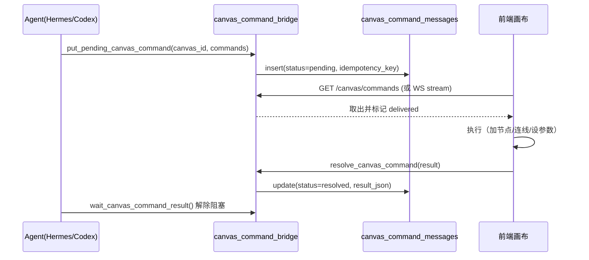

# 09 画布 Freezone

Freezone 是产品里自由度最高的部分：一块无限画布，节点可以是图片、视频、音频、文本、HTML、3D 舞台，也可以是一个「Recipe」（可复用的生成流水线）。它占后端 29,827 行（54 文件）、114 个端点、27 种任务类型。

## 1. 一条必须记住的边界

**画布的图结构由前端持有，后端不解析节点语义。**

后端只做四件事：

| 职责 | 文件 |
|---|---|
| 版本化存盘（快照 + 历史 + 软删 + 幂等） | `freezone/canvas_store.py`（908 行） |
| 命令投递（Agent → 前端执行 → 回执） | `freezone/canvas_command_bridge.py`（1,173 行） |
| 生成执行（按节点参数调模型、落盘） | `freezone/jobs.py`（3,033 行）、`freezone/*_node.py` |
| 提交回主线（把画布产物写进项目正式槽位） | `freezone/slots.py`（509 行） |

所以「后端能不能帮我改节点位置」的答案是：不能，只能通过命令让前端改。这也意味着画布 schema 的真相在前端 `features/canvas/`，后端只按 JSON Schema 校验 envelope。

## 2. 画布存储

### 2.1 文件布局

```text
output/<user>/<project>/freezone/
├── _uploads/            上传的原始素材
├── outputs/<job_id>/    生成产物
├── canvases/*.json      画布快照（当前版本）
├── _history/<canvas>/   历史版本（按 revision）
├── _deleted/            软删的画布
└── _idempotency/        幂等键记录
```

### 2.2 三个保护机制

| 机制 | 实现 | 触发 |
|---|---|---|
| **乐观锁** | 请求带 `base_revision`，与磁盘不符抛 `CanvasRevisionConflict` | 两人同时编辑 |
| **幂等** | `canvas_idempotency_key`（请求哈希），同键返回既有结果 | 网络重试、双击 |
| **危险覆盖保护** | `check_dangerous_empty_overwrite()`：空画布覆盖非空画布直接拒绝 | 前端状态丢失后自动保存 |

载荷上限默认 **5 MiB**（`FREEZONE_CANVAS_PAYLOAD_LIMIT_BYTES`），超限报 413 并给出 `oversized_canvas_diagnostics()`。画布只存"引用"（URL/路径/参数），不存 base64 媒体——这是它能保持小体积的前提。

### 2.3 版本与恢复

- 每次保存产生一个 revision，历史文件按 revision 命名；
- `restore_canvas_version()` 恢复到指定版本，但**不删除**中间版本；
- `prune_canvas_history()` 按保留策略裁剪；
- 软删进 `_deleted/`，可恢复；`prune_orphan_locks()` 清理残留锁文件。

## 3. 并发与锁

```text
flock(canvas_lock.py)  ← 单机
   └── ports/canvas_mutex.py  ← 抽象
         ├── local: FileLockCanvasWriteMutex（就是那把 flock）
         └── EE: 分布式租约
```

为什么要抽象：CE 单机 `flock` 完全够用；多机部署时两把本地锁互不可见，会同时写同一画布。`CanvasLeaseLost` 表示租约过期（写太久），需要重新取锁重试。

## 4. 媒体作用域守卫

一个容易被忽略的安全点：画布保存时 URL 可以指向**别的项目**的媒体。源项目 owner 打开正常，换成另一个合法成员就是整片 403。

`freezone/canvas_media_scope.py` 的做法：

- `scan_foreign_media_refs()` 扫描画布内所有媒体引用，比对当前项目；
- `reject_new_foreign_media_refs()` 只拒绝**新增**的跨项目引用，历史数据放行（兼容老画布）；
- 跨项目粘贴走 `asset_copy.py`：把源文件复制成目标项目 `_uploads/` 下的新文件，重写 URL。

## 5. 节点类型与后端分工

前端节点类型有几十种，后端按「需要模型/需要落盘」分类处理：

| 节点类别 | 前端（`features/canvas/`） | 后端处理 | 任务类型 |
|---|---|---|---|
| 图片生成/编辑 | `ImageGenNode`、`ImageEditNode` | `freezone/jobs.py`、`freezone/image_node.py` | `freezone_gen`、`freezone_edit`、`freezone_mask_edit` |
| 视频生成 | `VideoNode`、`StoryboardGenNode` | `freezone/video_node.py`（1,367 行） | `freezone_video_gen` |
| 视频编辑 | `VideoOperationsPanel`、`VideoCropOverlay` | `jobs.py`（erase/upscale/compose/breakdown） | `freezone_video_*` |
| 音频 | `AudioNode`、`VoiceSelectionModal` | `freezone/audio_node.py`（1,039 行） | `freezone_audio_*` |
| 文本 | `TextAnnotationNode`、`ScriptNode` | `freezone/text_node.py`（744 行） | `freezone_text_*` |
| 标记识别 | `Mark` 相关 | `freezone/mark_node.py` | 同步调用视觉模型 |
| 多视角/重打光/扩图 | `MultiAngleEditor*`、`LightEditor*`、`OutpaintEditorOverlay` | `freezone/route_helpers.py` | `freezone_gen` 的变体 |
| 360 全景 / 3GS 舞台 | `Pano360ViewerNode`、`ThreeDWorldNode` | `director_world/*`、`runners/stage_asset.py` | `stage_asset`、`scene_pano_generation` |
| HTML 产物 | `HtmlArtifactNode` | `freezone/html_artifacts.py` | 无（同步文件操作） |
| Recipe / Skill | `SkillNode`、`WorkflowDraftContinuation` | `freezone/recipe_runtime.py`、`agent_workflows/*` | `freezone_workflow_confirm` |

## 6. 命令桥（Agent 改画布的唯一通道）

Agent 无法直接改前端内存里的图，于是有一条 SQLite 消息队列：



| 设计点 | 说明 |
|---|---|
| 幂等键 | `canvas_command_idempotency_key()`：同一命令重复投递不重复执行 |
| 租约 | `lease_expires_at` + `delivery_attempts`，超时可重投 |
| 超时清理 | `expire_bridge_messages()`；`next_bridge_deadline()` 给调度器 |
| 信号 | 目录信号只是「提示」，真相在 SQLite（`canvas_command_watch.py`） |
| 四种桥 | 画布命令、画布上下文、Skill 工作室、澄清问题，各有独立 key 前缀 |

`canvas_command_watch.BridgeWatchHub` 是 worker 本地的目录监听器：信号丢了不影响正确性，只是延迟多一点。

## 7. Skill 与 Recipe

两个概念别混：

| 概念 | 定义 | 位置 |
|---|---|---|
| **Skill** | 一个可执行的能力单元，有输入/输出契约 | `freezone/skill_registry.py`（`SkillDefinition`） |
| **Recipe** | 一段可复用的生成流水线（多步 + 模型参数） | `freezone/recipe_runtime.py`、`agent_workflows/catalog.py` |

Skill 运行：

1. 前端 `POST .../freezone/skills/runs`（或 Agent 调工具）；
2. 后端校验 `SkillRunRequest`，按 `SkillInputSpec` 解析输入（支持引用上游节点产物）；
3. 执行 → 产出 `CanvasGraphPatch`（要加到画布上的节点/边）；
4. 前端应用 patch；结果通过 `run_id` 查询。

Recipe 编译：

1. Agent 写 `WorkflowPlan`（严格 JSON）；
2. `workflow_plan.validate_workflow_plan()` + `workflow_semantics.text_edge_error()` 校验；
3. `recipe_runtime.compile_recipe_prompt()` 编译成可执行节点 prompt（可批量、可并发）；
4. 编译结果与 operation id 绑，便于审计与计费。

覆盖与来源：内置 catalog 在包内，用户自定义在 `state/<user>/freezone/agents`，项目级可覆盖。`agent_config_store.py` 管用户级，`agent_bundle_store.py` 管社区 Bundle（安装/导出，带 semver 与许可证校验）。

## 8. 工作流（多步编排）

| 层 | 文件 | 职责 |
|---|---|---|
| Schema | `workflow_schema.py`、`workflow_contract_generated.py` | 稳定 envelope 的 JSON Schema（生成的，勿手改） |
| 计划 | `workflow_plan.py`、`freezone/agent_workflows/catalog.py`（5,102 行） | 校验 Agent 写的计划、Skill 目录检索 |
| 图编译 | `agent_workflows/graph.py` | 计划 → 画布命令 |
| 预检 | `workflow_preflight.py` | 模型可用性、参数兼容、澄清请求 |
| 运行 | `workflow_runs.py` | 运行账本、动作状态、错误分类、租约 |
| 草稿 | `workflow_drafts.py` | 未确认的草稿（确认前不执行） |
| 事务 | `workflow_transactions.py` | 无模型调用的确定性准备/修订 |
| 观测 | `workflow_observation.py` | 进度摘要与保守恢复决策 |

运行状态：`pending` / `queued` / `running` / `blocked` / `failed` / `cancelled`。`blocked` 表示等用户确认或等上游节点，不是错误。

错误分类（`classify_workflow_error`）覆盖 `invalid_request`、`model_unavailable`、`model_not_found`、`quota_exhausted`、`authentication`、`content_policy`、`sensitivecontent`、`privacyinformation` 等，并附 `retryable` 标记。**只有 retryable 才自动重试**。

## 9. 提交回主线（slot）

画布产物要变成项目正式资产，必须经过 slot。22 个 slot 覆盖全部可提交流：

| 类别 | slot |
|---|---|
| Beat 级 | `FrameTarget`、`SketchTarget`、`DirectorRenderTarget`、`SelectedBackgroundTarget`、`VideoTarget`、`BeatAudioTarget` |
| 角色 | `IdentityTarget`、`IdentityCostumeTarget`、`IdentityPortraitTarget`、`PortraitTarget` |
| 场景 | `SceneMasterTarget`、`Scene360Target`、`SceneReverseMasterTarget`、`SceneSpatialLayoutTarget`、`SceneDirectorPano360Target` |
| 3GS | `Scene3gsActivePlyTarget`、`Scene3gsMasterPlyTarget`、`Scene3gsReversePlyTarget`、`Scene3gsPanoPlyTarget`、`Scene3gsCustomSceneTarget`、`Scene3gsCollisionGlbTarget` |
| 道具 | `PropRefTarget` |

提交流程：

1. `validate_source_for_slot()` 校验源文件（格式、尺寸、必要元数据）；
2. `backup_slot_if_exists()` 备份原文件（可回滚）；
3. 复制/转换到目标路径；
4. `sync_slot_after_write()` 更新索引与 DB 指针；
5. `compute_slot_impact()` + `record_slot_stale_marks()` 标记**受影响的 beat** 为 stale（例如换了场景母版，所有用该场景的渲染图都过期）。

第 5 步是这个系统里最实用的设计之一：它不自动重生成（太贵），但会告诉用户「这些 beat 需要重跑」。

## 10. Agent 产物与计费一致性

`freezone/agent_product_operations.py` 为每次「Agent 触发的可计费生成」建一条 operation：

| 字段 | 作用 |
|---|---|
| `operation_id` | 产物身份，跨任务稳定 |
| `idempotency_key` | 防重复扣费 |
| `status` | `pending → bound → finished / cancelled` |
| `model_evidence_json` | 实际调用的模型证据 |
| `task_id` / `root_task_id` | 关联任务树 |

`AgentProductSettlementPending` 是一个显式错误：产物已生成但结算未完成。这种情况下不返回成功，避免「白送」。

## 11. 静态 URL 与缩略图

- `canvas_static_urls.py`：把画布内 URL 在内存中迁移到当前项目域（避免硬编码旧路径）；
- `utils/thumbnails.py`：`/static` 大图按需生成缩略图（`?w=` 变体），带并发限制与预热；
- `preview_media.py`：HTML 产物的短期预览授权（签名 + 过期），只有签发需要用户权限。

## 12. 常见错误对照

| 错误 | 含义 | 处理 |
|---|---|---|
| `CanvasRevisionConflict` | 乐观锁冲突 | 拉最新版本，前端合并后重存 |
| `CanvasIdempotencyConflict` | 同幂等键不同载荷 | 换 key（说明前端重试逻辑有 bug） |
| `CanvasCorruptError` | JSON 损坏 | 从 `_history/` 恢复 |
| `DangerousEmptyCanvasOverwrite` | 空覆盖非空 | 确认前端是否初始化失败 |
| `CanvasPayloadTooLarge` | 超 5 MiB | 检查是否把 base64 写进节点 |
| `CanvasMediaScopeError` | 跨项目媒体引用 | 走 `asset_copy` 复制素材 |
| `WorkflowRunLeaseConflict` | 两个 runner 抢同一 run | 等租约过期或修 runner 心跳 |
| `RecipeRuntimeError` | Recipe 编译失败 | 看 `workflow_run_actions.error_category` |

## 13. 相关文档

| 想知道 | 去哪 |
|---|---|
| 59 个 freezone 文件逐个说明 | [files/06-freezone](files/06-freezone.md) |
| 前端画布 382 个文件怎么分层 | [10 §5](10-前端应用.md) |
| 画布任务的 27 种类型 | [05 §2.8](05-任务系统.md) |
| 114 个端点全表 | [06 §5.12](06-HTTP-API参考.md) |
