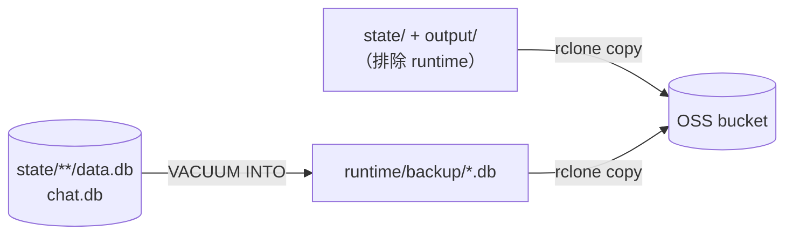

# 11 脚本、运维与备份

`scripts/` 共 36 个文件（27 个 `.py`、6 个 `.sh`、2 个 JSON 白名单、1 个 Dockerfile），其中 33 个可执行。它们分三类：**启动器**（要人跑）、**CI 门禁**（不该手动跑）、**一次性迁移**（跑完就该退休）。混淆它们的用途会出事。

## 1. 启动链路：`scripts/start-ce.sh`

这是本检出**唯一开箱可用**的启动方式。它做的事按顺序：

| 步骤 | 行为 | 失败表现 |
|---|---|---|
| 1 | 检查 `uv` / `pnpm` / `curl` 是否存在 | 退出码 2，提示安装方式 |
| 2 | 无 `.env` 时从 `.env.example` 复制 | 提示去配 `NEWAPI_BASE_URL` / `NEWAPI_API_KEY` |
| 3 | `source .env` | — |
| 4 | **强制 CE 模式**：`ST_EDITION=ce`、清空 `ST_CONTROL_PLANE_DSN`、`ST_REDIS_URL`、Celery broker/result | 防止 `.env` 里残留的 EE 配置把进程带偏 |
| 5 | 派生三类目录（`NOVELVIDEO_*_DIR`），默认落在仓库根 | 数据落不进系统临时目录 |
| 6 | 只允许 `DRAMACLAW_CHAT_BACKEND=codex` | 设了 claude/hermes 会直接拒绝 |
| 7 | 调 `setup-codex.sh` 解析补丁版 Codex，导出 `CODEX_BIN` | 下不到二进制 → 退出 |
| 8 | 检查 `NEWAPI_API_KEY`、`ffmpeg`，缺失只警告不阻断 | 能启动但生成必失败 |
| 9 | `uv sync --group dev` + `pnpm install`（仅首次） | 网络问题 |
| 10 | 后台起 API（默认 `:8780`），轮询 `/api/v1/config` 直到就绪（默认 90s） | 超时退出 1 |
| 11 | 后台起前端（默认 `:5173`） | — |
| 12 | `trap` 在 Ctrl-C / 退出时同时回收两个子进程 | 不会留孤儿进程 |

关键参数（都可用环境变量覆盖）：

| 变量 | 默认 |
|---|---|
| `NOVELVIDEO_API_PORT` | `8780` |
| `NOVELVIDEO_API_HOST` | `0.0.0.0` |
| `SUPERTALE_FE_PORT` | `5173` |
| `NOVELVIDEO_API_READY_TIMEOUT` | `90`（秒） |

## 2. 33 个可执行脚本逐个说明

### 2.1 启动与安装（4）

| 脚本 | 用途 | 前置 | 备注 |
|---|---|---|---|
| `start-ce.sh` | 本地一键起 API + 前端 | `uv`、`pnpm`、`curl`、`ffmpeg` | 唯一推荐入口 |
| `setup-codex.sh` | 下载/校验补丁版 Codex（0.164.0，来自 `claymorelab/codex` 指定 commit），只把路径打到 stdout | 网络、可执行权限 | `start-ce.sh` 内部调用；也可单独跑 |
| `setup-hermes.sh` | 安装 Hermes fork（`hermes-agent[acp]`）并校验 ACP 工具集 | Python 工具链 | 用 Hermes 后端才需要 |
| `bump_compose_default.py` | 改 compose 文件里某个变量的 `:-` 默认值 | 有 compose 文件 | 本检出缺 compose，实际用不到 |

### 2.2 CI 门禁（11，**硬零**，不要手动改代码绕过）

| 脚本 | 守什么 | 违反后果 |
|---|---|---|
| `check_dco.py` | 每个 commit 带 `Signed-off-by` | PR 拒绝 |
| `lint_ce_imports.py` | CE 代码不得 import 控制面模块 | 构建失败 |
| `lint_ee_terms.py` | 源码/文案不得出现 EE 专有名词与包名 | 构建失败 |
| `check_ce_port_closure.py` | 跨版本能力必须走已注册端口 | 构建失败 |
| `check_dependency_licenses.py` | 依赖许可证在白名单内 | 构建失败 |
| `check_env_config.py` | `.env.example` ↔ 代码读取点 ↔ 文档三方一致 | 构建失败 |
| `check_backend_i18n.py` | 后端面向用户文案必须走 i18n（棘轮，只减不增） | 构建失败 |
| `check_frontend_i18n.py` | 前端不得硬编码中文 | 构建失败 |
| `lint_banned_words.py` | 发布文案禁用词 | 构建失败 |
| `check_workflow_agent_contracts.py` | Workflow MCP / Skill / Recipe 契约端到端只读校验 | 构建失败 |
| `ce_allowlist.py` | 上面几个守栏共用的白名单加载器（`ce-allowlist.toml`） | 被 import，不单独跑 |

「棘轮」的意思是：允许清单只减不增，新代码必须合规。

### 2.3 生成与发布（4）

| 脚本 | 用途 | 影响面 |
|---|---|---|
| `generate_workflow_contract.py` | 从 `schemas/workflow/v1/stable-contract.json` 生成后端 `workflow_contract_generated.py` 与前端常量 | **改 schema 后必须跑**，否则前后端契约漂移 |
| `publish_official_media_catalog.py` | 把官方媒体模型清单发布到 OSS（不可变版本 + manifest） | 影响所有 CE 实例的模型列表 |
| `build_style_gallery.py` | 把飞书导出的风格素材转成 `style-gallery` 静态资源与清单 | 风格库 |
| `fetch_browser_models.py` | 准备浏览器端推理（抠图/深度）的自托管模型目录 | 画布本地能力 |

### 2.4 数据迁移与清理（5，一次性）

| 脚本 | 做什么 | 何时跑 |
|---|---|---|
| `migrate_docker_output.py` | 把旧 Docker 输出迁进持久卷 | 从旧部署升级时 |
| `convert_canvas_voice_refs.py` | 画布里的项目级音色引用改写成账号级 | 音色模型改版后 |
| `cleanup_html_artifact_exports.py` | 删除遗留的 HTML 导出 ZIP | 旧 worker 排空后 |
| `backfill_thumbnails.py` | 给历史项目补缩略图 | 缩略图功能上线后 |
| `scripts/compliance/` | 合规检查辅助 | 按需 |

### 2.5 诊断与基准（4）

| 脚本 | 用途 | 是否需要运行中的服务 |
|---|---|---|
| `benchmark_canvas_command_health.py` | 多订阅者下的 `/healthz` 中间件压测 | 是 |
| `benchmark_canvas_command_watch.py` | 空闲桥接 IO 与事件循环延迟 | 否 |
| `analyze_hermes_requests.py` | 从 dump 文件分析 Hermes 每次调用的 token 消耗 | 否 |
| `check_backend_i18n.py`（也列在门禁） | 可加 `--report` 看缺口 | 否 |

### 2.6 目录与配置（3）

| 路径 | 说明 |
|---|---|
| `scripts/acceptance/` | 验收脚本集（配合 `shared/api_coverage.py` 统计端点覆盖） |
| `scripts/benchmarks/` | 基准数据与结果 |
| `*.json`（2 个 allowlist） | i18n 白名单，改动需说明理由 |

## 3. 备份架构

备份分两条独立链路，**不要只做其中一条**：



### 3.1 数据库快照：`backup/db_daily.py`

- `snapshot_state_tree()` 遍历 `state/` 下所有 SQLite 文件；
- 对每个库执行 `VACUUM INTO`（**不是** `cp`）：得到一致性快照，不含 WAL 中间态；
- 输出到 `runtime/backup/`，再由文件同步链路推走；
- 前置：`wal_migrator.migrate_state_tree()` 把旧库转成 WAL 模式，否则快照期间可能锁表。

为什么不用 `cp`：直接复制 `data.db` 会漏掉 `-wal` 里已提交但未 checkpoint 的事务，恢复后丢数据。

### 3.2 文件同步：`backup/files_sync.py`

| 函数 | 作用 |
|---|---|
| `build_rclone_env()` | 从 `OSS_*` 变量拼 rclone 的 S3 配置（不落盘） |
| `build_sync_cmd()` | 构造 `rclone copy` 命令，带过滤规则 |
| `snapshot_hot_state()` | 对「正在写」的目录做一致性快照（`HotStateInventory`），避免同步到半个文件 |
| `HotSnapshotError` | 快照期间检测到文件变动过快，主动失败而不是传坏数据 |

`backup/scope.py` 定义**刻意不备份**的部分：`runtime/`、旧 Cognee 弃用路径、缓存目录。少传这些能显著降低费用。

### 3.3 恢复：`novelvideo backup` CLI

`backup/cli.py` 提供 Typer 子命令（`backup_app`）：

| 能力 | 说明 |
|---|---|
| `derive_region()` | 从 OSS endpoint 推导 `cn-*` 区域 |
| `build_restore_config()` | 生成临时 rclone 配置（用完即删） |
| `restore_cell()` | 恢复单个「cell」（一个用户的 `data.db` + `chat.db` + 文件） |
| `build_rclone_files_cmd()` | 构造反向同步命令 |

恢复是**按 cell** 而不是整库：`CELL_SQLITE_RELS = ("data.db", "chat.db")`。这样单项目损坏不影响其他人。

### 3.4 备份检查清单

| 项 | 命令/位置 | 频率 |
|---|---|---|
| 快照是否产出 | `ls runtime/backup/*.db` | 每日 |
| 快照可打开 | `sqlite3 <snap> 'pragma integrity_check;'` | 每周 |
| OSS 上对象数是否增长 | rclone `ls` | 每周 |
| 恢复演练 | 在空目录跑一次 `restore_cell` | 每月 |

## 4. 常用运维命令

```bash
# 本地启动（推荐）
bash scripts/start-ce.sh

# 只起 API（已装好依赖）
uv run --no-sync novelvideo api --host 0.0.0.0 --port 8780

# 健康检查（返回公开运行时配置即视为就绪）
curl -fsS http://127.0.0.1:8780/api/v1/config

# 迁移场景名（历史数据修复）
uv run python -m novelvideo migrate-scene-names --help

# 修复路径不安全的资产名
uv run python -m novelvideo repair-asset-names --help

# 生成工作流契约（改 schema 后）
uv run python scripts/generate_workflow_contract.py

# 校验环境变量一致性
uv run python scripts/check_env_config.py
```

CLI 入口见 `src/novelvideo/cli.py`（Typer），子命令包括 `import-novel`、`cognee-*`、`generate`、`api`、`migrate-scene-names`、`repair-asset-names`。

## 5. 运维三件容易忽略的事

1. **`state/` 与 `output/` 必须一起备份**。只备 DB 会得到一堆指向不存在文件的记录；只备文件则丢索引与选中关系。
2. **`_shared/` 目录要单独考虑**。它跨项目累积（训练样本、失败模式），删项目时不应被清掉；`backup/scope.py` 已排除，但自定义清理脚本常忘。
3. **迁移脚本只能跑一次**。`convert_canvas_voice_refs` 这类脚本重复跑会二次改写引用，先备份再执行。

## 6. 相关文档

| 想知道 | 去哪 |
|---|---|
| 每个脚本的源码位置与实现 | [files/11-scripts与tests](files/11-scripts与tests.md) |
| 备份涉及的表结构 | [04](04-数据模型与SQLite表.md) |
| 启动后怎么配模型 | [13](13-安装部署与运行.md) |
| 门禁失败怎么修 | [15 §4](15-维护与更新.md) |
