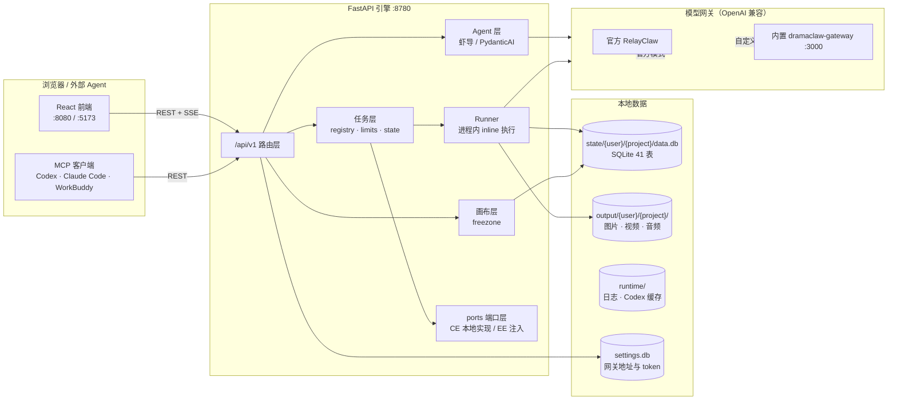
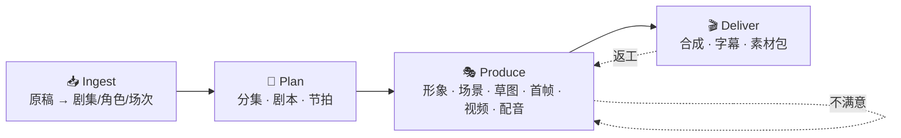
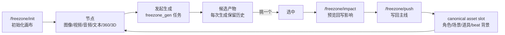
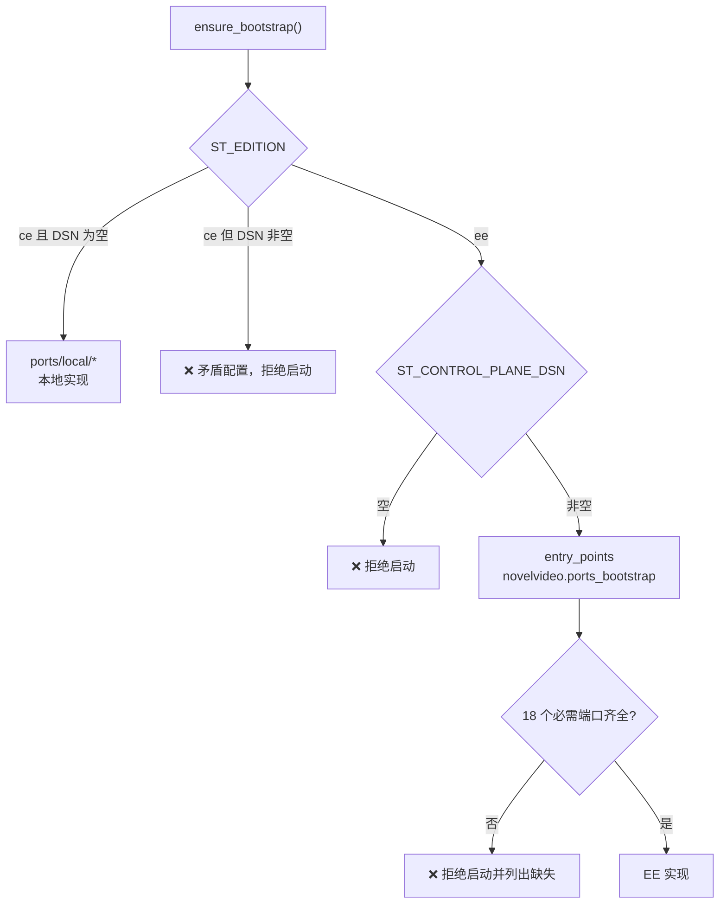

# 03 · 核心功能与关键流程

> 本篇是「代码怎么跑起来」的主干。前端所有页面、后端所有路由，最终都可以归到这里的四条主线 + 一条画布支线。

---

## 1. 全景图



**三条不变量**（改代码时别破坏）：

1. **路由层薄。** 路由只做参数校验 + 权限 + 拼装调用，业务逻辑落在 `services/`、`agents/`、`freezone/`、`task_backend/runners/`。
2. **长任务一律异步。** 任何超过秒级的生成动作都注册成任务类型，经任务层执行，前端靠 SSE 订阅进度。
3. **运行时依赖走端口。** 路由与 runner 不直接碰数据库连接池/Redis/Celery，一律 `get_port(...)`。

---

## 2. 四阶段流水线

产品的官方叙事是 **Ingest → Plan → Produce → Deliver**（摄取、规划、生产、交付）。每个阶段都有独立接口，可顺序跑、跳步跑、从任意检查点续跑。



### 2.1 摄取 Ingest

**两条路径，由项目创建时永久决定**（`projects.py` 写入 `KNOWLEDGE_PIPELINE_STRUCTURED`）：

| 路径 | 适用 | 机制 | 绑定 embedding？ |
|---|---|---|---|
| **structured（新项目默认）** | 新建项目 | `structured_ingest.py` 直接解析原稿，构建 episodes / characters / scenes，**不建知识图谱** | 否（创建时即决定，不可后期切换） |
| legacy（Cognee 图谱） | 旧项目 | `cognee/` 建图谱 → 角色/关系/时间线可查询检索 | 是 |

支持原著小说与剧本格式（含 Fountain）。入口：

```
POST /api/v1/projects/{p}/ingest/upload      # 上传原稿
POST /api/v1/projects/{p}/ingest/start       # 启动摄取
GET  /api/v1/projects/{p}/ingest/graph       # 查看摄取结果（角色/场次概览）
```

对应任务类型：`ingest_fast`、`build_episodes`、`build_characters`、`build_scenes`、`build_props`。

> **为什么要区分：** 新路径之所以不建图，是因为图谱需要 embedding 模型绑定，而这个绑定一旦写入就永久生效。社区用户换模型的成本远高于收益，所以新项目默认走纯结构化。这是 `projects.py` 里那段注释明确说明的设计决策。

### 2.2 规划 Plan

| 步骤 | 接口 | 任务类型 | 产物 |
|---|---|---|---|
| 分集规划 | `POST /projects/{p}/episodes/plan` | `episode_planner` 智能体 | `episodes` 表：集号、标题、摘要、悬念点 |
| 剧本生成 | `POST /projects/{p}/episodes/{n}/script/generate` | `script_writer` | `beats` 表：节拍、画面描述、旁白、台词 |
| 身份规划 | `POST .../identities/plan`（含 `plan-async`） | `identity_planner` | 角色/道具的身份方案 |
| 场景规划 | `POST .../scenes/plan` | `episode_scene_planner` | 本集场景清单 |
| 道具规划 | `POST .../props/plan` | `episode_prop_planner` | 本集道具清单 |
| 视频提示词 | `POST .../beats/{b}/video-prompt/generate` | `beat_video_prompt` | beat 级视频提示词 |

**剧本三种模式**（`workflows/script_writing.py` 与 `literal_script_writing.py`）：

- **改编（adaptive）**：自由创作，允许重写情节
- **直译（literal）**：严格贴合原文
- **分镜稿（staged）**：直接产出可拍分镜

**审校-修复循环**是质量的关键：`agents/episode_reviewer.py` 打分 → `episode_fixer.py` 定向修复 → 再评。`verification/convergence_log.py` 记录收敛轮次，超过阈值才放行或明确标记降级。

### 2.3 生产 Produce

| 产物 | 任务类型 | 说明 |
|---|---|---|
| 角色形象 | `character_portrait`、`identity_image` | 身份一致性核心：同一角色跨镜头共用参考 |
| 场景参考图 | `scene_reference_asset`、`scene_pano_generation` | 后者产出 360° 全景 |
| 道具三视图 | `prop_reference_asset` | — |
| 镜头草图 | `sketch_generation`、`sketch_grid_generation`、`sketch_regen`、`grid_regenerate`、`selected_regen` | 草图网格 + 池选 |
| 草图编辑执行 | `sketch_edit_execute` | 把导演控制意图落到草图 |
| 单镜视频 | `single_video` | 图生视频/关键帧生视频，Seedance 2 有专链 `seedance2_i2v/` |
| 视频全局优化 | `global_optimize_video` | 跨镜一致性优化 |
| 配音 | `stage_asset`（+ `audio/indextts2_beat_audio_task.py`） | 情绪感知 TTS，逐 beat |
| 画布内生成 | `freezone_gen`、`freezone_image_vectorize`、`director_control_to_sketch` | 画布发起 |

**资产一致性机制**（理解这点就理解了产品的护城河）：

```
角色 identity  ──┬──> 全局肖像（character_portrait）
                 └──> 单集变体（identity_image，允许本集换装/换状态）
                        │
                        └──> beat 级引用（beats.identity_refs）
                                │
                                └──> 提示词 + 参考图 → 生成
```

`utils/identity_resolver.py` 负责把"某个 beat 里出现的角色"解析成"具体用哪张参考图"，`render_plan/ref_image_hash.py` 保证同一参考图哈希稳定，从而让生成结果可复现。

### 2.4 交付 Deliver

| 步骤 | 入口 | 说明 |
|---|---|---|
| 单集合成 | `compose_episode` 任务 / `POST .../episodes/{n}/compose` 相关路由 | ffmpeg 拼接视频 + 音轨 + 字幕 |
| 导出 | `export/episode_export.py` | 成片 MP4 + 字幕 + 整套素材包 |
| 封面 | 画布 `compose/CoverEditor.tsx` | 截图/上传生成封面 |

**渲染参数**由项目级渲染设置控制（`GET/PATCH /projects/{p}/render-settings`），默认值见 [04 §4](04-依赖与配置说明.md#4-环境变量分组)：1080×1920 / 30fps / libx264 / 4M。

---

## 3. 任务生命周期

### 3.1 任务类型清单（28 种）

在 `task_backend/runners/` 中通过 `register_project_task_runner()` 注册：

| 分组 | 任务类型 |
|---|---|
| 摄取/构建 | `ingest_fast`、`build_episodes`、`build_characters`、`build_scenes`、`build_props` |
| 规划 | `episode_scene_planner`、`episode_prop_planner`、`identity_planner`、`script_writer`、`beat_video_prompt` |
| 形象/参考 | `character_portrait`、`identity_image`、`scene_reference_asset`、`prop_reference_asset`、`scene_pano_generation` |
| 草图 | `sketch_generation`、`sketch_grid_generation`、`sketch_regen`、`grid_regenerate`、`selected_regen`、`sketch_edit_execute`、`director_control_to_sketch` |
| 视频 | `single_video`、`global_optimize_video`、`compose_episode` |
| 资产/画布 | `stage_asset`、`freezone_gen`、`freezone_image_vectorize`、`skill_import`（导入类） |

### 3.2 状态机

```
       ┌──────────── 配额校验失败 → 429（不入库）
       │
   [submitting] --投递成功--> [queued] --worker 取到--> [running]
                                                          │
                                          ┌───────────────┼───────────────┐
                                          ▼               ▼               ▼
                                     [completed]      [failed]       [cancelled]
```

- **活跃态**（`ACTIVE_PROJECT_TASK_STATUSES`）：`submitting` / `queued` / `running`
- **终态**（`TERMINAL_TASK_STATUSES`）：`completed` / `failed` / `cancelled`
- **持久化优先**：worker 完成时**先写 SQLite 再退出**，前端优先从 SQLite 读最终结果。这解决"worker 死了拿不到结果"的经典问题（见 `task_state.py` 模块 docstring）。
- **日志**：每任务保留最近 100 条（`MAX_LOGS`），完成后状态保留 1 小时（`COMPLETED_TTL`）。
- **超时**：`STARTING_TIMEOUT` 防任务卡在 starting。

### 3.3 执行与观测

| 环节 | 模块 | 要点 |
|---|---|---|
| 投递 | `producer.py` + `envelope.py` + `signing.py` | 任务信封 HMAC 签名，防投递途中身份被改写。单机首次启动自动生成 keyring（`<STATE_DIR>/task_envelope_keyring.json`）；多主机共跑必须共享同一 keyring |
| 执行 | `run_core.py` + `runners/*` | CE 为后台线程内联执行；runner 返回 `dict` 即结果 |
| 队列 | `queues.py` | 4 条 lane：`default` / `video` / `world` / `ffmpeg`，名形如 `node.<home_node>.<lane>` |
| 放置 | `registry.py::ProjectTaskPlacement` | 是否必须在家节点（`requires_home_node`）+ lane。EE 靠它做跨机调度，CE 全在本机 |
| 进度 | SSE `/projects/{p}/tasks/stream` | 单任务也有 `/tasks/{type}/{episode}/stream` |
| 取消 | `cancel.py` | `DELETE /tasks/{type}/{episode}` |
| 续跑 | checkpoint | 从任务已有产物继续，不重跑已完成步骤 |
| 清理 | `DELETE /tasks/completed` | 清理已完成记录 |

### 3.4 配额五级守卫

`app.py` 把五种超额统一映射为 **HTTP 429**，但 `data.limit_scope` 区分来源，提示文案也不同：

| 异常 | `limit_scope` | 场景 | 提示语要点 |
|---|---|---|---|
| `ProjectTaskLimitExceeded` | `project` | 项目内某 lane 满了 | 等本项目任务完成 |
| `ProjectUserTaskLimitExceeded` | `user` | 项目内你自己的任务满了 | 等自己的任务完成 |
| `GlobalLaneQueueLimitExceeded` | `global_lane_queue` | 全局 lane 排队上限 | 稍后再提交 |
| `ChannelTaskLimitExceeded` | `channel` / `platform` | 渠道/共享池满 | 平台池满时**不说"渠道"**（请求可能不属于任何渠道） |
| `UserTaskLimitExceeded` | `user` | 用户级在途上限 | 等自己的任务完成 |

另有 **402**（`InsufficientCreditsError`）与 **409**（`BillingRuleNotConfiguredError`），CE 下通常不触发，但异常处理器始终在位，避免 EE 插件化后 500。

---

## 4. 画布闭环（freezone / 虾画）

画布是代码量最大的子系统（59 个模块）。它的核心不是"画图"，而是**候选（candidate）→ 落定（commit）**这条资产管理链路。



| 环节 | 关键模块 / 接口 | 说明 |
|---|---|---|
| 画布文档 | `freezone/canvas_store.py`、`GET /freezone/canvases` | 一张画布一份 JSON 文档；支持多画布 tab、锁（`canvas_lock.py`）、修订历史（`history.py`） |
| 节点类型 | `image_node.py`、`audio_node.py`、`mark_node.py`、`slots.py` | 18 种节点；每节点保留自己的生成历史 |
| 生成 | `jobs.py` + `freezone_gen` 任务 | 统一入口，按模态分发 |
| 上传/引用 | `POST /freezone/upload`、`/reference-file-upload`、`/assets/copy` | 参考图/参考视频；上限 5 MB 走 `referenceMediaLimits.ts` + 后端校验 |
| 回写主线 | `/freezone/impact` → `/freezone/push` | **先预览影响再提交**，避免误覆盖 |
| 技能/配方 | `skill_registry.py`、`recipe_runtime.py`、`agent_catalog/`、`agent_workflows/` | 技能与配方可安装/导出/分享；导入有质量与安全审查（`skill_import_*.py`） |
| 场景扩展 | `/freezone/extract-frames`、`/analyze-shots`、`/video-breakdown`、`/three-d-viewer/screenshot`、`/director-capture` | 抽帧、镜头分析、3D 取景、导演捕获 |

**术语对照**（读代码必备）：

| 代码词 | 中文 | 含义 |
|---|---|---|
| candidate | 候选 | 一次生成的产物，未落定 |
| canonical / slot | 正式资产 / 槽位 | 已落定、被主线引用的资产位置 |
| commit / push | 落定 / 写回 | 候选 → 槽位 |
| impact | 影响面 | 覆盖槽位会波及哪些集/镜 |
| recipe | 配方 | 可复用的多节点编排 |
| skill | 技能 | 单节点一键动作 |

---

## 5. Agent 与外部接入

### 5.1 虾导（Xia Director）

前端右侧的对话面板，后端在 `chat/`。三种后端，由 `DRAMACLAW_CHAT_BACKEND` 选择（优先级 `DRAMACLAW_ → SUPERTALE_ → 默认 codex`）：

| 后端 | 实现 | 说明 |
|---|---|---|
| `codex`（默认） | `codex_app_server.py`、`chat/backend_sdk.py` | 需凭据保护版 Codex 运行时（**不能用官方 stock CLI**）；`scripts/setup-codex.sh` 下载并按 SHA256 校验 |
| `hermes` | `hermes_sdk.py`、`hermes_pool.py`、`hermes_workspace.py` | 需 `uv tool install 'hermes-agent[acp]'`；跑在 OS 沙箱中（见下） |
| `claude` | `backend_sdk.py` | Claude Agent SDK |

**显式指定不存在的后端会直接抛错，绝不静默回落**——这是有意的：静默回落会让"我明明配了 hermes"变成难查的悬案。

### 5.2 Agent 能做什么

| 能力 | 实现 |
|---|---|
| 项目问答、进度查询 | `chat/dramaclaw_mcp.py`（内置 MCP server，只读+受控写） |
| 驱动流水线任务 | MCP 工具 → REST |
| 在画布上建图/跑图 | `chat/workflow_mcp.py`、`frontend/src/features/freezone/canvasCommand*.ts` |
| 自动推进（Auto） | `chat/director_auto.py`，启动时由 `app.py` 恢复（失败非致命） |
| 对外暴露 | `.mcp.json` 声明 `uv run python -m novelvideo.chat.dramaclaw_mcp`，`DRAMACLAW_CE_OWNER=1` 标识单用户身份；`agent-kit/` 提供多客户端接入清单 |

### 5.3 Hermes 沙箱（安全关键）

`security/sandbox_wrap.py` 给 Hermes worker 包一层 OS 沙箱：macOS 用 `sandbox-exec`（Seatbelt 策略在 `deploy/sandbox/*.sbpl`），Linux 用 `codex-linux-sandbox`（默认走 bubblewrap）。

决策矩阵（两个执行点共用同一判定）：

| 环境 | 沙箱不可用时的行为 |
|---|---|
| EE / 生产（`SUPERTALE_ENV=production` 或 `ST_CONTROL_PLANE_DSN` 非空） | **拒绝**（运行时抛错 / 容器拒绝启动），`SUPERTALE_ALLOW_UNSANDBOXED` 无法覆盖 |
| 单租户 CE + `SUPERTALE_ALLOW_UNSANDBOXED=1` | **降级**：大声警告后无沙箱运行（单租户无跨用户读风险） |
| CE 未设该开关 | **拒绝** |

> Linux 沙箱默认**不启用**（`SUPERTALE_LINUX_SANDBOX` 未设）。原因写在 `AGENTS.md`：codex 的 `restricted` profile 最窄的读授权仍是宽泛的 `root`，包裹后同宿主上的 Hermes 仍能**读**邻居的 `state/output/runtime`。该缺口只能在部署层（按用户挂载卷）关闭，profile 层关不掉。详见 issue #346。

---

## 6. 端口与适配器（六边形架构）

`ports/registry.py` 是全局注入点，`ensure_bootstrap()` 在启动时决定装哪套实现：



**18 个 EE 必需端口**（缺一不可，列在 `_EE_REQUIRED_PORTS`）：
`auth`、`auth_session`、`project_registry`、`project_access`、`audit_sink`、`credit_quote`、`usage_meter`、`provider_instrumentation`、`task_backend`、`task_envelope_consumer`、`cancellation_store`、`lifecycle`、`product_surface_access`、`model_credentials`、`authz`、`egress`、`egress_operations`、`video_result_delivery`

> `release_feed` 与 `media_model_catalog` **故意不在列表里**：它们有 CE 自带兜底，列进去会让 EE 因为"CE 能自己解决的事"而拒绝启动。

**CE 默认实现在 `ports/local/`**（12 个文件）：`auth`（免登录单用户）、`project`（SQLite 索引）、`tasks`（inline）、`audit`（NDJSON）、`credit_quote`（0）、`usage`（no-op）、`lifecycle`（no-op）、`egress`/`egress_operations`、`canvas_mutex`（进程内锁）、`projection`、`release_feed`。

**铁律**：核心代码永不 import 企业代码。门禁在 `scripts/lint_ce_imports.py` + `scripts/check_ce_port_closure.py` + `ce-allowlist.toml`。

---

## 7. 数据模型与存储

### 7.1 目录布局

```
<DATA_ROOT>/                      # NOVELVIDEO_DATA_ROOT，Docker 内为 /data
├── state/<user>/<project>/
│   ├── data.db                   # 项目结构化数据（SQLite）
│   ├── project.json              # 项目级配置（knowledge pipeline 等）
│   └── task_envelope_keyring.json
├── output/<user>/<project>/      # 图片 / 视频 / 音频 / 导出
├── runtime/                      # api.log（10 MB × 3 轮转）、Codex 缓存
└── settings.db                   # 全局设置：网关地址、token（不放 .env）
```

### 7.2 SQLite 表（41 张，按域分组）

| 域 | 表 |
|---|---|
| 故事结构 | `episodes`、`beats`、`scenes`、`characters`、`props`（5） |
| 项目与迁移 | `projects`、`schema_migrations`、`novelvideo_schema_components`（3） |
| 生成与选择 | `outcomes`、`reject_buffer`、`accepted_sketch_samples`、`sketch_format_versions`（4） |
| 任务 | `task_states`、`workflow_runs`、`workflow_run_actions`、`workflow_drafts`、`director_auto_runs`（5） |
| 用量 | `image_request_usage`、`video_request_usage`、`audio_request_usage`（3） |
| 画布 | `canvas_command_messages`、`freezone_agent_generation_sessions`、`freezone_agent_product_operations`、`freezone_recipe_model_prompts`、`live_edit_traces`（5） |
| 对话 | `chat_messages`、`chat_ui_events`、`chat_settings`（3） |
| 质量 | `evidence_counters`、`entity_evidence`、`convergence_rounds`、`human_override_events`、`sketch_failure_modes` / `_defs` / `_hits`（7） |
| 结构化摄取 | `story_analysis_runs`、`story_analysis_chunks`、`story_analysis_item_cache`、`story_analysis_artifacts`（4） |
| 其他 | `seedance2_voice_audio_records`、`runtime_settings`（2） |

**schema 演进**：`sqlite_schema.py` + `novelvideo_schema_components` 做组件化版本登记；`sqlite_pragmas.py` 统一设置 WAL 等 PRAGMA（`litestream_enabled()` 时启动会跑一次 WAL 迁移）。

### 7.3 资产命名

`utils/asset_names.py` / `asset_resolver.py` 统一命名与解析。**注意历史坑**：名字里带 `/` 或纯 `.` 的存量资产会让 `{name}` 路由 404（uvicorn 在路由匹配前把 `%2F` 还原成真斜杠），因此有专门的修复命令 `novelvideo repair-asset-names`（详见 [06](06-常见问题与使用示例.md)）。

---

## 8. 维护提示

| 改动 | 必查 |
|---|---|
| 新增任务类型 | 在 `runners/` 注册 + 声明 `ProjectTaskPlacement`；同步本页 §3.1 与 [02 §4](02-目录结构与模块划分.md#4-task_backend-任务执行) |
| 改任务状态机 | `task_state.py` 的三个状态集合常量；`tests/contract/test_m03_task_completion.py` |
| 新增端口 | `ports/registry.py::_EE_REQUIRED_PORTS`（若 EE 必需）+ 本页 §6 + `tests/ports/test_registry.py`（双向推导） |
| 改画布候选/落定语义 | 本页 §4 + `docs/canvas-reply-outcome-contract.md` |
| 新增 SQLite 表 | `sqlite_schema.py` 组件版本 + 本页 §7.2 |
| 改沙箱策略 | `AGENTS.md`「Hermes Sandbox」节 + `tests/test_sandbox_linux_probe.py` + `tests/test_compose_ce_unsandboxed_gate.py` |

_最后更新：2026-11-04_
