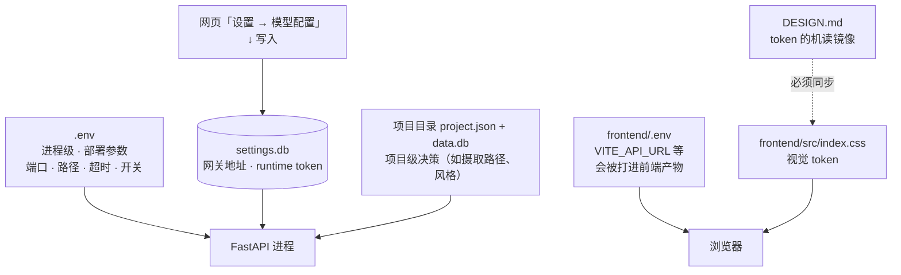

# 04 · 依赖与配置说明

> 本篇解决两件事：**装什么**、**配哪里**。
> 配置文件有四个层级，最容易搞混的是「哪些该写 `.env`，哪些该写网页设置」——见 §3。

---

## 1. Python 依赖

依赖声明在 `pyproject.toml`，真相在 `uv.lock`。`requires-python = ">=3.11,<3.13"`。

### 1.1 版本锁定的六个坑（改依赖前必读）

这些不是随手写死的版本，每一条都有代码注释说明原因。**不要"顺手升个版本"**。

| 依赖 | 锁定 | 原因（注释原文摘要） | 升级条件 |
|---|---|---|---|
| `pydantic-ai-slim[...]` | `==1.107.0` | 2.x 移除了 `Agent(output_retries=...)`，而场景/道具/资产规划器与校验器仍在传该参数，升级后报 `Agent.__init__() got an unexpected keyword argument 'output_retries'` | 需先完成 `output_retries → retries={'output': N}` 迁移 |
| `openai-codex` | git pin `25b5957f...#subdirectory=sdk/python` | SDK **协议**版本与发行镜像内置的凭据保护版 Codex 运行时配套；不能用 SDK 自带的 stock 二进制 | 随 Codex 运行时升级同步改 |
| `cognee` | `==1.0.5` | 知识图谱 API 不稳定，锁死可复现 | 单独 PR + 迁移测试 |
| `numpy` | `>=1.24.0,<2.0.0` | 生态兼容（Cognee 等） | 需全链路验证 |
| `click` | `<8.2.0` | typer 兼容 | 随 typer 一起升 |
| `ruff` | `==0.15.20` | 规则集冻结为 `E4/E7/E9/F`，避免升级引入新规则导致门禁漂移 | 扩规则需单独 PR |

### 1.2 运行时依赖分组

| 分组 | 包 | 用途 |
|---|---|---|
| Agent / LLM | `pydantic-ai-slim[anthropic,google,openai,openrouter]`、`openai`、`openai-codex`、`litellm`、`claude-agent-sdk`、`mcp`、`cognee` | 智能体、网关客户端、MCP、图谱 |
| Web 框架 | `fastapi`、`uvicorn[standard]`、`gunicorn`、`sse-starlette`、`httpx`、`websockets` | REST + SSE 流 |
| CLI | `typer`、`click`、`rich` | `novelvideo` 命令 |
| 数据库 | `aiosqlite`、`psycopg[binary]`、`asyncpg`、`pymysql` | SQLite 主存储；PG/MySQL 仅 EE 或外部数据源 |
| 媒体与图像 | `Pillow`、`edge-tts`、`dashscope`、`numpy`、`python-docx` | 图像、TTS、文档解析 |
| 对象存储 | `oss2`、`boto3` | 参考图 relay（可选功能） |
| 工具 | `pypinyin`、`python-ulid`、`portalocker`、`jsonschema`、`packaging`、`nest-asyncio`、`python-dotenv` | 拼音排序、ID、文件锁、schema 校验 |
| 文本语言 | `langdetect`、`langid`、`wordninja`、`markdown-it-py` | 语种识别、分词、Markdown |
| Windows | `pywin32==312`（仅 `sys_platform == 'win32'`） | 平台适配 |

### 1.3 可选 extra 与开发组

| 组 | 内容 | 何时装 |
|---|---|---|
| `[world]` | `torch`、`torchvision`、`timm`、`transformers`、`einops`、`huggingface-hub`、`safetensors`、`plyfile`、`scipy`、`matplotlib`、`imageio`、`pillow-heif`、`jaxtyping` + `sharp`(ml-sharp) + `da2` | 3DGS / 体素 / 全景转 3D。**需要 GPU + CUDA**；CPU 环境只能走慢速路径 |
| `dev` | `pytest`、`pytest-asyncio`、`pytest-xdist`、`fakeredis`、`respx`、`ruff` | 开发与 CI |

```bash
uv sync --group dev            # 常规开发
uv sync --extra world          # 需要 3D 世界能力（必须用 uv，依赖覆盖才生效）
```

> **`[tool.uv.dependency-metadata]` 的作用**：上游 `sharp` 依赖含 `gsplat`（渲染器，通常需 CUDA 编译），而 SHARP 的预测路径并不 import 它。这里覆盖其依赖元数据去掉 `gsplat`，让 CPU / 无 CUDA 环境（含 CE Docker）能干净安装。同一机制也用于 `da2`。**这是 `uv sync --extra world` 必须用 uv 而不能用 pip 的原因。**

### 1.4 外部工具依赖

| 工具 | 用途 | 配置方式 |
|---|---|---|
| **ffmpeg** | 视频拼接、转码、抽帧 | 装在 PATH，或 `FFMPEG_PATH` 指定；默认编码 `libx264` + `aac` |
| **uv** | 依赖管理与运行 | <https://docs.astral.sh/uv/> |
| **pnpm 11.5.0** | 前端依赖 | `corepack enable && corepack prepare pnpm@11.5.0 --activate` |
| **Codex 运行时** | 虾导默认后端 | `scripts/setup-codex.sh` 自动下载 + SHA256 校验，缓存在 `runtime/codex/bin/`；也可 `CODEX_BIN` 指定自有版本 |
| **splat-transform**（npm） | 3DGS PLY → PlayCanvas SOG | `npm install -g @playcanvas/splat-transform`；可用 `ST_SPLAT_TRANSFORM_BIN` 覆盖 |

---

## 2. 前端依赖

`frontend/package.json`，锁在 `frontend/pnpm-lock.yaml`。核心：

| 类别 | 包 |
|---|---|
| 框架 | `react` 19、`react-dom` 19、`typescript` 5.8 |
| 构建 | `vite` 6、`@vitejs/plugin-react`、`@tailwindcss/vite` |
| 路由/数据 | `@tanstack/react-router`、`@tanstack/react-query`、`@tanstack/react-virtual` |
| 状态 | `zustand` |
| 画布/图形 | `@xyflow/react` 12、`konva` + `react-konva`、`playcanvas`、`ogl`、`@photo-sphere-viewer/core` |
| UI | `tailwindcss` 4、`shadcn`、`@radix-ui/*`、`@base-ui/react`、`lucide-react`、`sonner`、`framer-motion`、`gsap`、`lenis` |
| 表单/校验 | `react-hook-form`、`@hookform/resolvers`、`zod` |
| 媒体 | `@ffmpeg/ffmpeg` + `@ffmpeg/core`（浏览器内处理）、`mediabunny`、`@breezystack/lamejs`、`react-image-crop` |
| 文本 | `react-markdown`、`remark-gfm`、`remark-breaks`、`dramaclaw-spec-render` |
| i18n | `i18next`、`react-i18next`、`i18next-http-backend` |
| 测试 | `vitest`、`@testing-library/*`、`msw`、`jsdom` |

**Node 版本**：Vite 6 要求 Node 18+，工程实际以 Node 20/22 验证。前端包管理器版本由 `packageManager: pnpm@11.5.0` 声明。

**脚本**：

```bash
pnpm dev        # 开发服务器 :5173
pnpm build      # tsc -b && vite build
pnpm build:ce   # CE 模式构建
pnpm test       # vitest run
```

---

## 3. 配置分层（最容易搞错的地方）



| 层 | 位置 | 放什么 | 谁改 |
|---|---|---|---|
| **部署配置** | `.env` | 端口、数据路径、超时、并发、沙箱开关、镜像版本 | 运维 / 开发者 |
| **模型配置** | `settings.db`（网页写入） | 网关地址、DC key、runtime token、官方/自定义/混合模式 | 最终用户 |
| **项目配置** | `state/<user>/<project>/project.json` + `data.db` | 摄取路径（结构化/图谱）、风格模板、渲染设置、旁白音色 | 应用内操作 |
| **前端构建配置** | `frontend/.env` / `.env.ce` | `VITE_API_URL`、`VITE_EDITION`、`VITE_FREEZONE_URL`、`VITE_CLUSTER_*` | 前端开发/发布 |
| **视觉配置** | `frontend/src/index.css` ↔ `DESIGN.md` | 颜色、字号、间距、圆角、动效 | 前端（**必须同 commit 双写**） |

> **关键规则：模型渠道和 key 不写 `.env`。** CE 把它们存在本机 `settings.db`，由网页配置向导写入。`.env` 里只有 `NEWAPI_TEXT_TIMEOUT_SECONDS` 这类行为参数。这样做的好处是：换 key 不用重启容器。

---

## 4. 环境变量分组

> `.env.example`（23 KB，逐项中文注释）是**权威全集**。这里按组归纳高频项。

### 4.1 版本与运行环境

| 变量 | 默认 | 说明 |
|---|---|---|
| `ST_EDITION` | `ce`（compose/启动器强制） | `ce` / `ee`。CE 不可降级 |
| `ST_CONTROL_PLANE_DSN` | 空 | 非空即视为 EE；**CE 下必须为空**，否则启动即报矛盾配置 |
| `ST_REDIS_URL`、`ST_CELERY_BROKER_URL`、`ST_CELERY_RESULT_BACKEND` | 空 | EE/分布式专用 |
| `NOVELVIDEO_DATA_ROOT` | `.`（Docker 为 `/data`） | 数据根，下三项默认派生 |
| `NOVELVIDEO_STATE_DIR` | `$DATA_ROOT/state` | 项目 DB 与配置 |
| `NOVELVIDEO_OUTPUT_DIR` | `$DATA_ROOT/output` | 产物 |
| `NOVELVIDEO_RUNTIME_DIR` | `$DATA_ROOT/runtime` | 日志与运行时缓存 |
| `NOVELVIDEO_API_HOST` / `NOVELVIDEO_API_PORT` | `0.0.0.0` / `8780` | API 监听 |
| `DRAMACLAW_FRONTEND_DIST` | 空 | 设了才由后端直接伺服 SPA（无 nginx 的原生部署）；Docker/EE 不设 |
| `NOVELVIDEO_API_URL` / `DRAMACLAW_API_URL` / `SUPERTALE_API_URL` | `http://127.0.0.1:8780` | Agent 与内部调用回打地址；启动器会三写一致 |

### 4.2 模型网关

| 变量 | 默认 | 说明 |
|---|---|---|
| `NEWAPI_TEXT_TIMEOUT_SECONDS` | `120` | 文本模型 HTTP 超时 |
| `NEWAPI_TEXT_TRUST_ENV` | `true` | 是否读系统代理；内网网关被 Surge/Clash 拦时设 `false` |
| `NEWAPI_TEXT_CONTEXT_TOKENS` | 未设 | 开启本地上下文预算校验（须大于输出预算 + 1024） |
| `NEWAPI_ADMIN_BASE_URL` | `http://127.0.0.1:3000` | 网关管理地址（不带 `/v1`），用于自动开通 token |
| `NEWAPI_PROVISIONER_ENABLED` | — | 是否允许"一键初始化"内置网关 |
| `NEWAPI_SQLITE_PATH` / `NEWAPI_SQL_DSN` | — | 网关数据库位置（CE 固定 `./state/newapi/one-api.db`） |
| `OFFICIAL_MEDIA_CATALOG_MANIFEST_URL` / `_POLL_SECONDS` / `_URL` | OSS manifest / 300s | 官方媒体模型目录同步（仅 CE 启轮询任务） |

> 约 **30 个 `*_MODEL` 逻辑模型名**（如 `HERMES_MODEL=DC-hermes-LLM`）映射到网关后台的真实模型。**改模型不改代码，改网关映射。**

### 4.3 Agent / 虾导

| 变量 | 默认 | 说明 |
|---|---|---|
| `DRAMACLAW_CHAT_BACKEND`（旧名 `SUPERTALE_CHAT_BACKEND`） | `codex` | `codex` / `hermes` / `claude`。显式指定不可用后端 → **直接报错，不回落** |
| `CODEX_BIN` | 自动下载 | 指定自有凭据保护版可执行文件，跳过下载与校验 |
| `DRAMACLAW_CODEX_HOME` | `<STATE_DIR>/.codex-app-server` | App Server home（每 home node 共享一个进程） |
| `DRAMACLAW_CODEX_MODEL_CATALOG_FILE` | 随仓库提供 | 仅在网关 alias 能力不同时覆盖 |
| `DRAMACLAW_LOCAL_AGENT_TRUST` | 关 | **仅本机开发**：允许 loopback Agent 无 token 使用本场 owner 身份。任何可被外部访问的部署都不要开 |

### 4.4 沙箱与安全

| 变量 | 默认 | 说明 |
|---|---|---|
| `SUPERTALE_ENV` | — | 设 `production` 即按 EE/生产处理（沙箱不可用则拒绝启动） |
| `SUPERTALE_ALLOW_UNSANDBOXED` | 关 | 单租户 CE 的**降级阀门**：沙箱不可用时警告后裸跑 |
| `SUPERTALE_LINUX_SANDBOX` | 关 | 部署方显式声明"已按用户挂载隔离"，才可置 `1` |
| `PROMPT_EXPORT_PASSWORD` | `change_me` | 提示词导出口令，**部署必须覆盖** |
| `ST_COOKIE_SECURE` | `true` | 本机 HTTP 开发须设 `0`，否则浏览器丢弃 cookie |
| `ST_TASK_ENVELOPE_ACTIVE_KEY_ID` / `ST_TASK_ENVELOPE_KEYRING_B64_JSON` | 空 | 多主机共跑同一任务集时必填且需一致；单机留空自动生成 |

### 4.5 媒体参数

| 变量 | 默认 |
|---|---|
| `VIDEO_FPS` | `30` |
| `VIDEO_WIDTH` / `VIDEO_HEIGHT` | `1080` / `1920`（竖屏） |
| `VIDEO_CODEC` / `VIDEO_AUDIO_CODEC` | `libx264` / `aac` |
| `VIDEO_BITRATE` | `4M` |
| `IMAGE_DEFAULT_WIDTH` / `_HEIGHT` / `_STYLE` | `1440` / `2560` / `chinese_period_drama` |
| `FFMPEG_PATH` | `ffmpeg`（PATH） |

### 4.6 可选能力

| 变量 | 用途 |
|---|---|
| `OSS_RELAY_AK` / `_SK` / `_ENDPOINT` / `_BUCKET` | 参考图 relay（阿里 OSS）。**不配则参考图功能不可用**，纯文本→成片仍可跑 |
| `MEDIA_RELAY_PROVIDER` | `oss` / `s3` / `cloudinary` |
| `RELEASE_NOTIFICATIONS_ENABLED` / `_GITHUB_TOKEN` | 版本更新通知（默认开；`false` 可完全关闭） |
| `NOVELVIDEO_ENABLE_LOGFIRE`、`OTEL_EXPORTER_OTLP_TRACES_ENDPOINT`、`LOGFIRE_TOKEN` | 追踪埋点。**三者默认都不设，不发送任何数据** |

### 4.7 Docker / 镜像（仅 compose 生效）

| 变量 | 说明 |
|---|---|
| `DRAMACLAW_VERSION` | 发行版本，如 `2.1.1` |
| `DRAMACLAW_GATEWAY_VERSION` | 网关镜像 tag，如 `v1.0.0-rc.24-dramaclaw.3` |
| `DRAMACLAW_IMAGE_PREFIX` | 镜像仓库前缀；国内可切阿里 ACR（只有钉过的 tag，无 latest） |
| `DRAMACLAW_GATEWAY_SRC` | 网关源码路径或 git URL（源码构建默认 `../dramaclaw-gateway`） |
| `ST_NEWAPI_PORT` / `ST_NEWAPI_BIND` | 网关宿主端口（默认 3000）/ 绑定地址（默认 `127.0.0.1`） |

---

## 5. 端口与目录约定

| 端口 | 服务 | 说明 |
|---|---|---|
| `8780` | REST API | 后端唯一入口，前缀 `/api/v1` |
| `8080` | Web UI | Docker 下由 `web` 容器（nginx）接管，反代到 api |
| `5173` | 本地开发前端 | Vite dev server，`/api/v1` 与 `/static` 代理到 8780 |
| `3000` | 内置网关管理后台 | 默认只绑 `127.0.0.1`；远程访问需 `ST_NEWAPI_BIND=0.0.0.0` |
| `5175` / `5176` | 画布独立应用（可选） | `VITE_FREEZONE_URL` 指向 |

| 路径 | 内容 |
|---|---|
| `<DATA_ROOT>/state` | 项目 SQLite、`project.json`、`settings.db`、任务信封 keyring |
| `<DATA_ROOT>/output` | 图片 / 视频 / 音频 / 导出成品 |
| `<DATA_ROOT>/runtime` | `api.log`（10 MB×3 轮转）、Codex 运行时缓存 |
| `frontend/dist` | 前端构建产物（`DRAMACLAW_FRONTEND_DIST` 指向它） |

---

## 6. 配置校验与门禁

| 门禁 | 作用 |
|---|---|
| `scripts/check_env_config.py` + `tests/test_env_config_ratchet.py` | 防止环境变量默认值被无声改动（棘轮机制） |
| `.gitleaks.toml` + `pre-commit` | 阻止密钥入库 |
| `scripts/check_ce_port_closure.py` | CE 发行边界（不引用 EE） |
| `scripts/check_dependency_licenses.py` | 许可证合规（配 `license-inventory.csv`） |
| `frontend/src/index.css` ↔ `DESIGN.md` | `npx @google/design.md lint DESIGN.md` 必须 0 error |

---

## 7. 维护提示

| 改动 | 必同步 | 校验 |
|---|---|---|
| 新增/改环境变量 | `.env.example`（含注释）+ 本页 §4 + `docs/zh/`、`docs/en/` 下的 `reference/environment-variables.md` | `check_env_config.py` |
| 升 Python 依赖 | 本页 §1.1（若涉及锁定项）+ `uv.lock` | `uv sync --group dev && uv run pytest` |
| 升前端依赖 | 本页 §2 + `pnpm-lock.yaml` | `pnpm build && pnpm test` |
| 改端口/默认路径 | 本页 §5 + [01 §7](01-项目概述.md#7-维护提示) | `test_env_config_ratchet.py` |
| 改视觉 token | `frontend/src/index.css` ↔ `DESIGN.md` | `design.md lint` 0 error / ≤15 warning |

_最后更新：2026-11-04_
